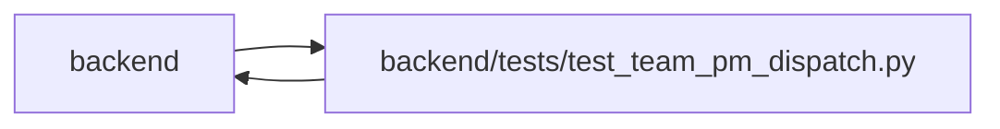

# test_team_pm_dispatch Module

**Path:** `backend/tests/test_team_pm_dispatch.py`

## Description

Authenticated PM queue commands across the REST and MCP transports.

## Imports

| Source | Symbols |
|--------|---------|
| `app` | `database`, `mcp_server` |
| `app.authority` | `AuthorityError` |
| `app.commands` | `command_transaction` |
| `app.config` | `get_settings` |
| `app.main` | `app` |
| `app.models.agent` | `AgentActor`, `AgentTaskAssignment`, `TaskEvent` |
| `app.models.identity` | `ProjectMembership`, `WorkspaceMembership` |
| `app.models.iteration` | `Iteration` |
| `app.models.project` | `Project` |
| `app.services.identity_service` | `IdentityService`, `initialize_control_plane` |
| `contextlib` | `asynccontextmanager`, `nullcontext` |
| `httpx` | `httpx` |
| `json` | `json` |
| `pytest` | `pytest` |
| `sqlalchemy` | `select` |
| `sqlalchemy.ext.asyncio` | `async_sessionmaker`, `create_async_engine` |
| `tests.test_agent_team_setup_qualification` | `provision_ready_topology`, `routing_base` |

## Local dependency map

<!-- Auto-generated local dependency summary. Do not edit by hand. -->

> Module-level dependencies exceed the generated-diagram limits, so the diagram and table below group them by top-level package. Counts report the number of module neighbors in each package.

### Internal neighbors

| Direction | Module |
|---|---|
| Inbound | `backend` (7) |
| Outbound | `backend` (12) |

### External packages

| Language | Used packages | Undeclared packages |
|---|---:|---:|
| python | 3 | 1 |

> All 19 module neighbor(s) are summarized by package because the module-level view exceeds the 12-node limit.

## Functions

| Function | Signature | Decorators | Description |
|----------|-----------|------------|-------------|
| `db_session_factory` | *(async)* `(request, db_session_factory)` | `@pytest.fixture` | — |
| `assignment_api` | *(async)* `(transport, db_session_factory, monkeypatch)` | `@asynccontextmanager` | — |
| `test_pm_dispatch_changes_only_the_selected_team_queues` | *(async)* `(db_session, db_session_factory, team_member_factory, task_factory, transport, auth_mode, monkeypatch)` | `@pytest.mark.usefixtures('deployed_agent_skill_release')`, `@pytest.mark.parametrize('transport', ['rest', 'mcp'])`, `@pytest.mark.parametrize('auth_mode', ['trusted_local', 'managed'])`, `@pytest.mark.parametrize('db_session_factory', [pytest.param('sqlite', marks=pytest.mark.sqlite), pytest.param('postgresql', marks=[pytest.mark.postgresql, pytest.mark.allow_network])], indirect=True)` | — |
| `test_dispatch_queue_permission_is_single_use_and_excludes_actor_administration` | *(async)* `(db_session, db_session_factory, actor_factory, change)` | `@pytest.mark.sqlite`, `@pytest.mark.parametrize('change', ['identity', 'scopes', 'delete', 'second_advance'])` | — |
