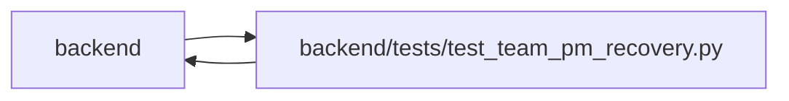

# test_team_pm_recovery Module

**Path:** `backend/tests/test_team_pm_recovery.py`

## Description

Authenticated recovery and claim-fenced blocker reporting.

## Imports

| Source | Symbols |
|--------|---------|
| `app` | `database`, `mcp_server` |
| `app.config` | `get_settings` |
| `app.main` | `app` |
| `app.models.agent` | `AgentActor`, `AgentRun`, `AgentTaskAssignment`, `TaskEvent` |
| `app.models.capacity` | `PlanningState` |
| `app.models.identity` | `ProjectMembership`, `WorkspaceMembership` |
| `app.models.iteration` | `Iteration` |
| `app.models.project` | `Project` |
| `app.models.task` | `Task` |
| `app.services.agent_routing_policy` | `ROUTING_LINEAGE_AUTHORITY` |
| `app.services.agent_service` | `hash_api_key` |
| `app.services.identity_service` | `IdentityService`, `initialize_control_plane` |
| `contextlib` | `asynccontextmanager`, `nullcontext` |
| `httpx` | `httpx` |
| `json` | `json` |
| `pytest` | `pytest` |
| `sqlalchemy` | `select` |
| `tests.test_agent_team_setup_qualification` | `provision_ready_topology`, `routing_base` |
| `tests.test_supervised_shadow_rework` | `topology_with_two_reviewers` |
| `tests.test_team_pm_dispatch` | `db_session_factory` |

## Local dependency map

<!-- Auto-generated local dependency summary. Do not edit by hand. -->

> Module-level dependencies exceed the generated-diagram limits, so the diagram and table below group them by top-level package. Counts report the number of module neighbors in each package.

### Internal neighbors

| Direction | Module |
|---|---|
| Inbound | `backend` (9) |
| Outbound | `backend` (16) |

### External packages

| Language | Used packages | Undeclared packages |
|---|---:|---:|
| python | 3 | 1 |

> All 24 module neighbor(s) are summarized by package because the module-level view exceeds the 12-node limit.

## Functions

| Function | Signature | Decorators | Description |
|----------|-----------|------------|-------------|
| `recovery_api` | *(async)* `(transport, factory, monkeypatch)` | `@asynccontextmanager` | — |
| `routing_mode` | `(monkeypatch, mode)` | — | — |
| `test_controller_recovers_once_and_worker_begins` | *(async)* `(db_session, db_session_factory, team_member_factory, task_factory, transport, auth_mode, mode, monkeypatch)` | `@pytest.mark.usefixtures('deployed_agent_skill_release')`, `@pytest.mark.parametrize('mode', ['off', 'shadow'])`, `@pytest.mark.parametrize('transport', ['rest', 'mcp'])`, `@pytest.mark.parametrize('auth_mode', ['trusted_local', 'managed'])`, `@DATABASES` | — |
| `test_recovery_retains_ownership_outside_the_controller_team` | *(async)* `(db_session, db_session_factory, team_member_factory, task_factory, actor_factory, monkeypatch, foreign_owner)` | `@pytest.mark.sqlite`, `@pytest.mark.usefixtures('deployed_agent_skill_release')`, `@pytest.mark.parametrize('foreign_owner', ['assignment', 'run', 'claim'])` | — |
| `recovery_events` | *(async)* `(factory)` | — | — |
| `refused_requeue` | *(async)* `(factory, monkeypatch, task_id, key, payload, receipt)` | — | — |
| `test_recovery_moves_stale_team_ownership_without_lowering_model_review` | *(async)* `(db_session, db_session_factory, team_member_factory, task_factory, monkeypatch, mode)` | `@pytest.mark.usefixtures('deployed_agent_skill_release')`, `@pytest.mark.parametrize('mode', ['off', 'shadow', 'enforced'])`, `@DATABASES` | — |
| `test_recovery_outside_enforcement_is_executable_or_names_its_condition` | *(async)* `(db_session, db_session_factory, team_member_factory, task_factory, actor_factory, monkeypatch, mode, history)` | `@pytest.mark.usefixtures('deployed_agent_skill_release')`, `@pytest.mark.parametrize('mode', ['off', 'shadow'])`, `@pytest.mark.parametrize('history', ['several_reviewer_profiles', 'target_is_reviewer', 'pm_outside_team', 'unsupervised_rework'])`, `@DATABASES` | — |
