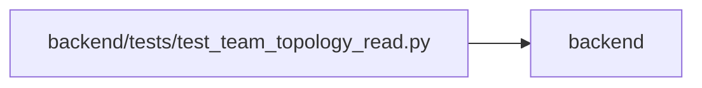

# test_team_topology_read Module

**Path:** `backend/tests/test_team_topology_read.py`

## Description

The team topology read names members, model bindings and runtime references, never credentials.

## Imports

| Source | Symbols |
|--------|---------|
| `app.mcp_server` | `mcp` |
| `app.models.agent` | `AgentActor` |
| `app.models.identity` | `Principal`, `WorkspaceMembership` |
| `app.models.user_session` | `UserSession` |
| `app.services.agent_service` | `AgentPermissionError` |
| `app.services.agent_team_setup_service` | `AgentTeamSetupService` |
| `app.services.identity_service` | `digest` |
| `app.utils.time` | `utc_now` |
| `datetime` | `timedelta` |
| `json` | `json` |
| `pytest` | `pytest` |
| `tests.test_agent_team_setup` | `operator` |
| `tests.test_agent_team_setup_qualification` | `provision_ready_topology` |
| `tests.test_delivery_scenarios` | `delivery_store` |
| `tests.test_managed_authority` | `client`, `managed_store` |
| `tests.test_observer_sessions` | `bearer`, `local_store`, `pair_managed` |

## Local dependency map

<!-- Auto-generated local dependency summary. Do not edit by hand. -->

> Module-level dependencies exceed the generated-diagram limits, so the diagram and table below group them by top-level package. Counts report the number of module neighbors in each package.

### Internal neighbors

| Direction | Module |
|---|---|
| Outbound | `backend` (13) |

### External packages

| Language | Used packages | Undeclared packages |
|---|---:|---:|
| python | 1 | 1 |

> All 13 module neighbor(s) are summarized by package because the module-level view exceeds the 12-node limit.

## Functions

| Function | Signature | Decorators | Description |
|----------|-----------|------------|-------------|
| `assert_no_credentials` | `(payload)` | — | — |
| `test_operator_reads_members_bindings_and_runtime_references` | *(async)* `(db_session)` | — | — |
| `test_a_pm_reads_only_its_bound_team_and_a_worker_cannot_read_it` | *(async)* `(db_session)` | — | — |
| `test_an_absent_team_reads_as_absent` | *(async)* `(db_session)` | — | — |
| `test_mcp_registers_the_topology_read_as_read_only` | *(async)* `()` | — | — |
| `test_workspace_people_and_their_observers_read_the_team_but_project_roles_do_not` | *(async)* `(managed_store)` | — | — |
| `test_an_agent_key_without_team_authority_is_refused_over_http` | *(async)* `(managed_store)` | — | — |
| `test_a_trusted_local_browser_reads_the_team` | *(async)* `(local_store)` | — | — |
