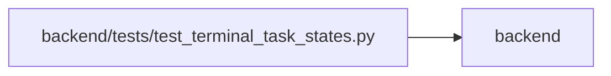

# test_terminal_task_states Module

**Path:** `backend/tests/test_terminal_task_states.py`

## Description

Canceled and superseded work is shown and counted as terminal, never under the status it kept.

## Imports

| Source | Symbols |
|--------|---------|
| `app` | `mcp_agent_tools` |
| `app.main` | `app` |
| `app.models.release` | `Release`, `release_tasks` |
| `app.models.task` | `Task` |
| `app.models.task_replacement` | `TaskReplacement` |
| `app.services.agent_service` | `AgentService` |
| `app.services.delivery_metrics_service` | `DeliveryMetricsService`, `summarize_observations` |
| `app.services.iteration_service` | `IterationService` |
| `app.services.planning_issues` | `missing_effort`, `needs_assignee` |
| `app.services.project_service` | `ProjectService` |
| `app.services.release_service` | `ReleaseService` |
| `app.services.task_display_state` | `task_state_clause` |
| `app.services.work_metrics` | `aggregate_metrics`, `leaf_metrics` |
| `app.utils.time` | `utc_now` |
| `datetime` | `date`, `timedelta` |
| `httpx` | `httpx` |
| `pytest` | `pytest` |
| `sqlalchemy` | `select` |
| `tests.test_delivery_scenarios` | `delivery_store` |
| `tests.test_task_supersession` | `_client`, `_scenario`, `_supersede` |
| `types` | `SimpleNamespace` |

## Local dependency map

<!-- Auto-generated local dependency summary. Do not edit by hand. -->

> Module-level dependencies exceed the generated-diagram limits, so the diagram and table below group them by top-level package. Counts report the number of module neighbors in each package.

### Internal neighbors

| Direction | Module |
|---|---|
| Outbound | `backend` (16) |

### External packages

| Language | Used packages | Undeclared packages |
|---|---:|---:|
| python | 3 | 1 |

> All 16 module neighbor(s) are summarized by package because the module-level view exceeds the 12-node limit.

## Functions

| Function | Signature | Decorators | Description |
|----------|-----------|------------|-------------|
| `_cancel` | *(async)* `(client, task)` | — | — |
| `_withdrawn_scenario` | *(async)* `(factory, scenario)` | — | A resolved original superseded by closed work, an active task canceled, and a replaced planned task. |
| `test_task_response_carries_the_displayed_state_and_successor` | *(async)* `(delivery_store)` | — | — |
| `test_iteration_project_and_milestone_counts_report_terminal_work_apart` | *(async)* `(delivery_store)` | — | — |
| `test_metric_matches_open_the_terminal_counts` | *(async)* `(delivery_store)` | — | — |
| `test_status_filters_keep_working_and_terminal_states_can_be_selected` | *(async)* `(delivery_store)` | — | — |
| `test_release_progress_counts_withdrawn_work_in_its_own_buckets` | *(async)* `(delivery_store)` | — | — |
| `test_release_target_overflow_ignores_canceled_work` | *(async)* `(delivery_store)` | — | — |
| `test_agent_pipeline_and_ready_tasks_skip_withdrawn_work` | *(async)* `(delivery_store)` | — | — |
| `test_delivery_analytics_counts_superseded_work_apart_from_canceled` | *(async)* `(delivery_store)` | — | — |
| `test_summarize_observations_never_counts_one_task_as_both_canceled_and_superseded` | `()` | — | — |
| `test_leaf_metrics_counts_terminal_leaves_apart_from_every_status` | `()` | — | — |
| `test_canceled_planned_work_is_no_planning_gap` | `()` | — | — |
| `test_queries_joining_the_replacement_table_still_compile_and_run` | *(async)* `(delivery_store)` | — | — |
