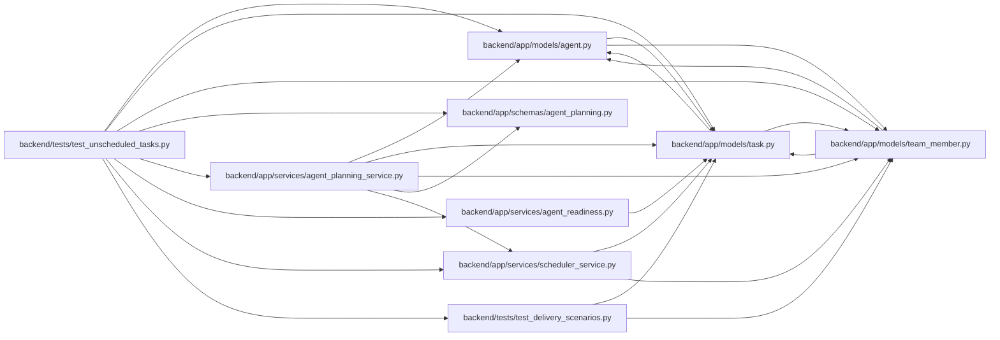

# test_unscheduled_tasks Module

**Path:** `backend/tests/test_unscheduled_tasks.py`

## Description

The scheduler says which planned tasks it left without dates, and readiness says how to fix it.

## Imports

| Source | Symbols |
|--------|---------|
| `app.models.agent` | `AgentActor` |
| `app.models.task` | `Task` |
| `app.models.team_member` | `TeamMember`, `TeamMemberProfile` |
| `app.schemas.agent_planning` | `AgentPlanningCommandContext`, `AgentScheduleCommand` |
| `app.services.agent_planning_service` | `AgentPlanningService` |
| `app.services.agent_readiness` | `evaluate_agent_readiness` |
| `app.services.scheduler_service` | `SchedulerService` |
| `pytest` | `pytest` |
| `sqlalchemy` | `select` |
| `tests.test_delivery_scenarios` | `delivery_store` |

## Local dependency map

<!-- Auto-generated local dependency summary. Do not edit by hand. -->

### Internal neighbors

| Direction | Module |
|---|---|
| Outbound | [models_agent](../modules/models_agent.md) |
| Outbound | [models_task](../modules/models_task.md) |
| Outbound | [team_member](../modules/team_member.md) |
| Outbound | [schemas_agent_planning](../modules/schemas_agent_planning.md) |
| Outbound | [agent_planning_service](../modules/agent_planning_service.md) |
| Outbound | [agent_readiness](../modules/agent_readiness.md) |
| Outbound | [scheduler_service](../modules/scheduler_service.md) |
| Outbound | [test_delivery_scenarios](../modules/test_delivery_scenarios.md) |

### External packages

| Language | Used packages | Undeclared packages |
|---|---:|---:|
| python | 2 | 1 |

## Functions

| Function | Signature | Decorators | Description |
|----------|-----------|------------|-------------|
| `_schedule_reason` | `(task: Task) -> tuple[bool, str]` | — | — |
| `test_readiness_names_the_missing_scheduling_step` | `(iteration_id, assignee_id, expected)` | `@pytest.mark.parametrize(('iteration_id', 'assignee_id', 'expected'), [(None, None, 'add it to an iteration'), (1, None, 'Assign it to a capacity row in this iteration'), (1, 7, 'run the scheduler for this iteration')])` | — |
| `test_scheduler_reports_unassigned_and_outside_assignee_tasks` | *(async)* `(delivery_store)` | — | — |
| `test_agent_capacity_row_assignment_and_apply_schedule_an_unassigned_task` | *(async)* `(delivery_store)` | — | — |
