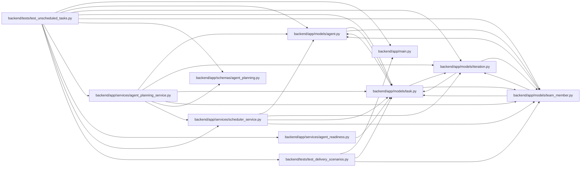

# test_unscheduled_tasks Module

**Path:** `backend/tests/test_unscheduled_tasks.py`

## Description

The scheduler says which planned tasks it left without dates, and readiness says how to fix it.

## Imports

| Source | Symbols |
|--------|---------|
| `app.main` | `app` |
| `app.models.agent` | `AgentActor`, `AgentActor` |
| `app.models.iteration` | `Iteration` |
| `app.models.task` | `Task`, `TaskDependency` |
| `app.models.team_member` | `TeamMember`, `TeamMemberProfile` |
| `app.schemas.agent_planning` | `AgentPlanningCommandContext`, `AgentScheduleCommand`, `AgentPlanningCommandContext` |
| `app.services.agent_planning_service` | `AgentPlanningService`, `AgentPlanningService` |
| `app.services.agent_readiness` | `evaluate_agent_readiness` |
| `app.services.scheduler_service` | `SchedulerService` |
| `datetime` | `date`, `timedelta` |
| `httpx` | `httpx` |
| `pytest` | `pytest` |
| `sqlalchemy` | `select` |
| `tests.test_delivery_scenarios` | `delivery_store` |

## Local dependency map

<!-- Auto-generated local dependency summary. Do not edit by hand. -->

### Internal neighbors

| Direction | Module |
|---|---|
| Outbound | [app_main](../modules/app_main.md) |
| Outbound | [models_agent](../modules/models_agent.md) |
| Outbound | [models_iteration](../modules/models_iteration.md) |
| Outbound | [models_task](../modules/models_task.md) |
| Outbound | [team_member](../modules/team_member.md) |
| Outbound | [schemas_agent_planning](../modules/schemas_agent_planning.md) |
| Outbound | [agent_planning_service](../modules/agent_planning_service.md) |
| Outbound | [agent_readiness](../modules/agent_readiness.md) |
| Outbound | [scheduler_service](../modules/scheduler_service.md) |
| Outbound | [test_delivery_scenarios](../modules/test_delivery_scenarios.md) |

### External packages

| Language | Used packages | Undeclared packages |
|---|---:|---:|
| python | 3 | 1 |

## Functions

| Function | Signature | Decorators | Description |
|----------|-----------|------------|-------------|
| `_schedule_reason` | `(task: Task) -> tuple[bool, str]` | — | — |
| `test_readiness_names_the_missing_scheduling_step` | `(iteration_id, assignee_id, expected)` | `@pytest.mark.parametrize(('iteration_id', 'assignee_id', 'expected'), [(None, None, 'add it to an iteration'), (1, None, 'Assign it to a capacity row in this iteration'), (1, 7, 'run the scheduler for this iteration')])` | — |
| `test_scheduler_reports_unassigned_and_outside_assignee_tasks` | *(async)* `(delivery_store)` | — | — |
| `test_agent_capacity_row_assignment_and_apply_schedule_an_unassigned_task` | *(async)* `(delivery_store)` | — | — |
| `test_schedule_omits_undated_deferred_work_on_apply` | *(async)* `(delivery_store)` | — | — |
| `_ownerless_chain` | *(async)* `(db, scenario)` | — | A task without a capacity owner, an owned dependent, an ownerless dependent and a dependent of that. |
| `_assert_chain_reported` | `(kept_dates, root, owned, ownerless, tail)` | — | — |
| `test_schedule_keeps_the_valid_dates_of_ownerless_task_and_every_dependent_it_cannot_place` | *(async)* `(delivery_store)` | — | — |
| `test_a_task_that_never_had_dates_is_not_reported_as_cleared` | *(async)* `(delivery_store)` | — | — |
| `_separate_shared_owner_iterations` | *(async)* `(db, scenario)` | — | The seeded owner sits in two overlapping iterations; move the second so a baseline commit is accepted. |
| `test_rest_schedule_and_preview_responses_name_tasks_that_keep_their_dates` | *(async)* `(delivery_store, monkeypatch)` | — | — |
| `test_agent_schedule_preview_names_tasks_that_keep_their_dates` | *(async)* `(delivery_store)` | — | — |
| `_imported_plan_with_unplaceable_tasks` | *(async)* `(db, scenario)` | — | Imported dates on tasks the scheduler cannot place: valid ones, and one for each rule they can break. |
| `test_schedule_keeps_imported_dates_and_names_the_rule_they_break` | *(async)* `(delivery_store)` | — | — |
| `test_kept_dates_say_when_they_start_before_the_planning_start_or_a_placed_prerequisite` | *(async)* `(delivery_store, monkeypatch)` | — | — |
| `test_following_actual_dates_restores_a_half_dated_task_without_failing` | *(async)* `(delivery_store)` | — | — |
| `test_schedule_preview_and_apply_agree_on_an_imported_plan` | *(async)* `(delivery_store, monkeypatch)` | — | — |
| `test_a_baseline_commit_does_not_commit_the_dates_it_kept` | *(async)* `(delivery_store, monkeypatch)` | — | — |
