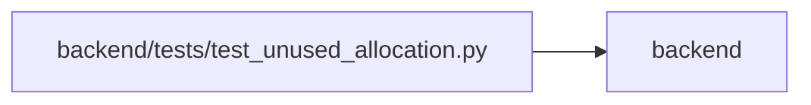

# test_unused_allocation Module

**Path:** `backend/tests/test_unused_allocation.py`

## Description

Capacity-row removal reserves planning while preserving unrelated issued work.

## Imports

| Source | Symbols |
|--------|---------|
| `app` | `database` |
| `app.authority` | `Authority` |
| `app.commands` | `AggregateVersionConflict`, `PlanningConflict`, `command_transaction`, `current_command`, `lock_iterations`, `lock_planning` |
| `app.config` | `get_settings` |
| `app.main` | `app` |
| `app.models.agent` | `AgentActor`, `AgentRun`, `AgentTaskAssignment` |
| `app.models.capacity` | `PlanningState` |
| `app.models.identity` | `ProjectMembership`, `WorkspaceMembership` |
| `app.models.iteration` | `Iteration` |
| `app.models.project` | `Initiative`, `Project` |
| `app.models.recovery` | `ApplicationSnapshot`, `TaskScheduleBaseline` |
| `app.models.task` | `Task` |
| `app.models.team_member` | `TeamMember`, `Vacation` |
| `app.models.triage` | `TriageClassificationSuggestion`, `TriageItem` |
| `app.schemas.agent` | `AgentTaskAssignmentCreate`, `ModelAwareAgentTaskAssignmentCreate` |
| `app.schemas.agent_routing` | `AgentRoutingPreviewCreate` |
| `app.services` | `allocation_removal` |
| `app.services.agent_planning_service` | `AgentPlanningService` |
| `app.services.agent_routing_service` | `AgentRoutingService` |
| `app.services.agent_service` | `hash_api_key` |
| `app.services.agent_work_service` | `AgentWorkService` |
| `app.services.identity_service` | `IdentityService`, `initialize_control_plane` |
| `app.services.snapshot_service` | `SnapshotService` |
| `app.services.team_service` | `TeamService` |
| `app.utils.time` | `utc_now` |
| `asyncio` | `asyncio` |
| `datetime` | `date`, `timedelta` |
| `hashlib` | `hashlib` |
| `httpx` | `httpx` |
| `json` | `json` |
| `pytest` | `pytest` |
| `sqlalchemy` | `select`, `text` |
| `tests.test_agent_routing_service` | `_assessment_command`, `_command_context`, `_routing_fixture` |
| `tests.test_agent_team_setup_qualification` | `provision_ready_topology`, `routing_base` |
| `tests.test_annual_calendar_work_control` | `apply_inputs`, `pm_headers` |
| `tests.test_review_provenance` | `database_engines` |
| `tests.test_team_pm_dispatch` | `db_session_factory` |
| `time` | `time` |

## Local dependency map

<!-- Auto-generated local dependency summary. Do not edit by hand. -->

> Module-level dependencies exceed the generated-diagram limits, so the diagram and table below group them by top-level package. Counts report the number of module neighbors in each package.

### Internal neighbors

| Direction | Module |
|---|---|
| Outbound | `backend` (30) |

### External packages

| Language | Used packages | Undeclared packages |
|---|---:|---:|
| python | 3 | 1 |

> All 30 module neighbor(s) are summarized by package because the module-level view exceeds the 12-node limit.

## Functions

| Function | Signature | Decorators | Description |
|----------|-----------|------------|-------------|
| `test_saved_allocation_uses_typed_decision_and_both_native_lineage_writers` | *(async)* `(db_session, db_session_factory, profile_factory, actor_factory, team_member_factory, task_factory)` | `@database_engines`, `@pytest.mark.usefixtures('qualified_model_aware_routing_test_context')` | — |
| `test_fresh_forecasts_apply_before_and_after_allocation_removal` | *(async)* `(db_session, db_session_factory, task_factory, profile_factory, team_member_factory, actor_factory, monkeypatch)` | `@database_engines` | — |
| `test_large_retained_history_is_checked_before_reserving_the_planning_writer` | *(async)* `(db_session, db_session_factory, task_factory, profile_factory, team_member_factory, actor_factory, monkeypatch, record_property)` | `@database_engines` | — |
| `restore_settings_cache` | `()` | `@pytest.fixture(autouse=True)` | — |
| `test_changed_history_epoch_requires_a_fresh_allocation_observation` | *(async)* `(db_session, db_session_factory, task_factory, team_member_factory, profile_factory, monkeypatch)` | `@database_engines` | — |
| `test_empty_allocation_preserves_issued_work` | *(async)* `(db_session, db_session_factory, task_factory, profile_factory, team_member_factory, actor_factory, monkeypatch, condition)` | `@database_engines`, `@pytest.mark.parametrize('condition', ['ordinary', 'unused'])` | — |
| `test_allocation_guard_preserves_references` | *(async)* `(db_session, db_session_factory, task_factory, team_member_factory, actor_factory, profile_factory, monkeypatch, reference)` | `@database_engines`, `@pytest.mark.parametrize('reference', ['closed-task', 'project', 'initiative', 'vacation', 'suggestion', 'finished-assignment', 'captured-route', 'issued-profile', 'review-floor', 'retained-reviewer', 'running-profile', 'saved-child', 'legacy-owner', 'unassigned-profile-owner', 'live-accepted-profile', 'route-malformed', 'route-nonobject', 'route-unknown-version', 'route-nested-other-key', 'route-float', 'opaque-legacy-removal', 'unknown-foreign-key', 'mixed-case-foreign-key', 'unknown-backend', 'history-missing-owner', 'history-null-children', 'history-object-children', 'history-unrelated', 'history-root-string', 'history-root-array', 'history-child-string', 'history-child-array'])` | — |
| `test_postgres_allocation_removal_serializes_with_dispatch` | *(async)* `(db_session, db_session_factory, team_member_factory, task_factory, monkeypatch, first, record_property)` | `@pytest.mark.parametrize('db_session_factory', [pytest.param('postgresql', marks=[pytest.mark.postgresql, pytest.mark.allow_network])], indirect=True)`, `@pytest.mark.parametrize('first', ['remove', 'issue'])`, `@pytest.mark.usefixtures('deployed_agent_skill_release')` | — |
| `test_allocation_removal_queued_behind_unrelated_planning_writer` | *(async)* `(db_session, db_session_factory, task_factory, team_member_factory, profile_factory, monkeypatch, reference, guarded, record_property)` | `@pytest.mark.parametrize('db_session_factory', [pytest.param('postgresql', marks=[pytest.mark.postgresql, pytest.mark.allow_network])], indirect=True)`, `@pytest.mark.parametrize('reference,guarded', [('current', False), ('retained', False), ('current', True), ('unproven', False)])` | — |
| `test_mixed_case_allocation_reference_blocks_snapshot_restore` | *(async)* `(db_session, db_session_factory, task_factory, team_member_factory, profile_factory, monkeypatch)` | `@database_engines` | — |
