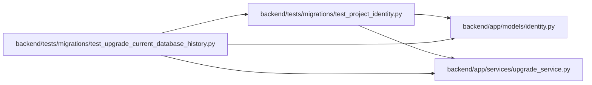

# test_upgrade_current_database_history Module

**Path:** `backend/tests/migrations/test_upgrade_current_database_history.py`

## Description

However much history a database has retained, it starts when current and migrates when not.

## Imports

| Source | Symbols |
|--------|---------|
| `app.models.identity` | `CommandAudit`, `Principal` |
| `app.services.upgrade_service` | `UpgradeError`, `run_alembic_upgrade` |
| `datetime` | `UTC`, `datetime` |
| `pytest` | `pytest` |
| `tests.migrations.test_project_identity` | `insert_legacy_project`, `legacy_store` |

## Local dependency map

<!-- Auto-generated local dependency summary. Do not edit by hand. -->

### Internal neighbors

| Direction | Module |
|---|---|
| Outbound | [models_identity](../modules/models_identity.md) |
| Outbound | [upgrade_service](../modules/upgrade_service.md) |
| Outbound | [test_project_identity](../modules/test_project_identity.md) |

### External packages

| Language | Used packages | Undeclared packages |
|---|---:|---:|
| python | 1 | 1 |

## Functions

| Function | Signature | Decorators | Description |
|----------|-----------|------------|-------------|
| `_retain_history` | `(engine, rows)` | — | — |
| `test_current_database_with_long_history_is_started_without_the_identity_scan` | `(tmp_path, configure_database)` | `@pytest.mark.sqlite` | — |
| `test_pending_migration_scans_all_of_a_long_history_before_it_rebuilds` | `(tmp_path, configure_database)` | `@pytest.mark.sqlite` | — |
| `test_pending_migration_refuses_an_ambiguous_row_beyond_the_former_bound` | `(tmp_path, configure_database)` | `@pytest.mark.sqlite` | — |
