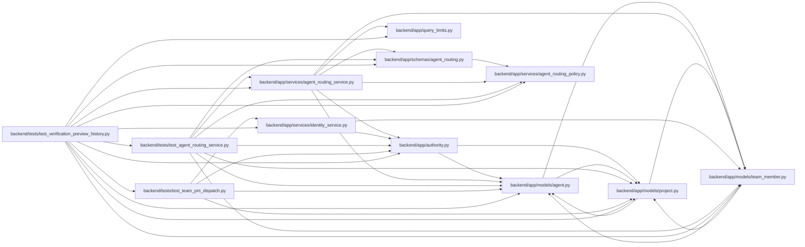

# test_verification_preview_history Module

**Path:** `backend/tests/test_verification_preview_history.py`

## Description

Verification previews keep assignment-based independence until the stricter policy is enabled.

## Imports

| Source | Symbols |
|--------|---------|
| `app.authority` | `Authority` |
| `app.models.agent` | `AgentModelBinding`, `AgentRun`, `AgentTaskAssignment` |
| `app.models.project` | `Project` |
| `app.models.team_member` | `TeamMemberProfileSkill` |
| `app.query_limits` | `CollectionLimitExceededError`, `MAX_BOUNDED_LIST_ITEMS` |
| `app.schemas.agent_routing` | `AgentRoutingPreviewCreate` |
| `app.services` | `agent_routing_service` |
| `app.services.agent_routing_policy` | `ROUTING_DECISION_AUTHORITY` |
| `app.services.agent_routing_service` | `AgentRoutingService` |
| `app.services.identity_service` | `initialize_control_plane` |
| `datetime` | `UTC`, `datetime` |
| `json` | `json` |
| `pytest` | `pytest` |
| `sqlalchemy` | `insert` |
| `tests.test_agent_routing_service` | `_assessment_command`, `_command_context`, `_rollout`, `_routing_fixture` |
| `tests.test_team_pm_dispatch` | `db_session_factory` |
| `unittest.mock` | `AsyncMock` |

## Local dependency map

<!-- Auto-generated local dependency summary. Do not edit by hand. -->

### Internal neighbors

| Direction | Module |
|---|---|
| Outbound | [authority](../modules/authority.md) |
| Outbound | [models_agent](../modules/models_agent.md) |
| Outbound | [models_project](../modules/models_project.md) |
| Outbound | [team_member](../modules/team_member.md) |
| Outbound | [query_limits](../modules/query_limits.md) |
| Outbound | [agent_routing](../modules/agent_routing.md) |
| Outbound | [agent_routing_policy](../modules/agent_routing_policy.md) |
| Outbound | [agent_routing_service](../modules/agent_routing_service.md) |
| Outbound | [identity_service](../modules/identity_service.md) |
| Outbound | [test_agent_routing_service](../modules/test_agent_routing_service.md) |
| Outbound | [test_team_pm_dispatch](../modules/test_team_pm_dispatch.md) |

### External packages

| Language | Used packages | Undeclared packages |
|---|---:|---:|
| python | 2 | 1 |

## Functions

| Function | Signature | Decorators | Description |
|----------|-----------|------------|-------------|
| `test_verification_preview_applies_execution_history_bound_only_for_strict_projects` | *(async)* `(db_session, profile_factory, actor_factory, team_member_factory, task_factory, monkeypatch)` | `@pytest.mark.asyncio`, `@pytest.mark.parametrize('db_session_factory', [pytest.param('sqlite', marks=pytest.mark.sqlite), pytest.param('postgresql', marks=[pytest.mark.postgresql, pytest.mark.allow_network])], indirect=True)` | — |
