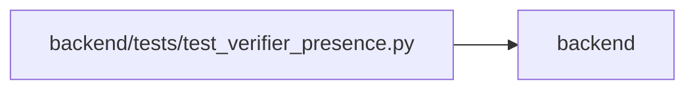

# test_verifier_presence Module

**Path:** `backend/tests/test_verifier_presence.py`

## Description

Verification needs the selected verifier present, not every declared team actor.

## Imports

| Source | Symbols |
|--------|---------|
| `app.authority` | `Authority` |
| `app.config` | `get_settings` |
| `app.models.agent` | `AgentActor`, `AgentTaskAssignment`, `AgentTeamTopologyMember` |
| `app.models.iteration` | `Iteration` |
| `app.schemas.agent` | `AgentReviewVerdict`, `AgentTaskAssignmentCreate`, `ModelAwareAgentTaskAssignmentCreate` |
| `app.schemas.agent_routing` | `AgentRoutingPreviewCreate` |
| `app.services.agent_routing_service` | `AgentRoutingConflictError`, `AgentRoutingService` |
| `app.services.agent_service` | `AgentPermissionError` |
| `app.services.agent_team_setup_service` | `AgentTeamSetupConflictError`, `AgentTeamSetupService` |
| `app.services.agent_work_service` | `AgentWorkService` |
| `app.utils.time` | `utc_now` |
| `datetime` | `timedelta` |
| `json` | `json` |
| `pytest` | `pytest` |
| `sqlalchemy` | `select` |
| `tests.support.transactions` | `reload_session_fixture` |
| `tests.test_agent_routing_service` | `_command_context` |
| `tests.test_agent_routing_wave6_qualification` | `_assessment_command`, `_dispatch` |
| `tests.test_agent_team_setup_qualification` | `default_candidate`, `provision_ready_topology`, `routing_base` |
| `tests.test_review_provenance` | `database_engines` |

## Local dependency map

<!-- Auto-generated local dependency summary. Do not edit by hand. -->

> Module-level dependencies exceed the generated-diagram limits, so the diagram and table below group them by top-level package. Counts report the number of module neighbors in each package.

### Internal neighbors

| Direction | Module |
|---|---|
| Outbound | `backend` (16) |

### External packages

| Language | Used packages | Undeclared packages |
|---|---:|---:|
| python | 2 | 1 |

> All 16 module neighbor(s) are summarized by package because the module-level view exceeds the 12-node limit.

## Classes

| Class | Line | Bases | Description |
|-------|------|-------|-------------|
| [Scene](../entities/Scene.md) | 32 | — | A resolved task, its team, and the ids that stay usable after a rollback. |

## Functions

| Function | Signature | Decorators | Description |
|----------|-----------|------------|-------------|
| `restore_settings_cache` | `()` | `@pytest.fixture(autouse=True)` | — |
| `resolved_task_with_team` | *(async)* `(db, team_member_factory, task_factory)` | — | — |
| `verification_preview` | *(async)* `(db, scene, *, actor = None)` | — | — |
| `assign_verifier` | *(async)* `(db, scene, preview, key, *, principal = None)` | — | — |
| `set_last_seen` | *(async)* `(db, actor_id, *, quiet)` | — | — |
| `set_enabled` | *(async)* `(db, actor_id, enabled)` | — | — |
| `pass_verdict` | `(assignment_id, task_version, candidate)` | — | — |
| `test_present_verifier_is_assigned_and_reviews_while_an_unrelated_actor_is_not` | *(async)* `(db_session, team_member_factory, task_factory)` | `@database_engines`, `@pytest.mark.usefixtures('deployed_agent_skill_release', 'qualified_model_aware_routing_test_context')` | — |
| `test_verifier_that_goes_stale_after_assignment_is_refused_at_verdict_time` | *(async)* `(db_session, team_member_factory, task_factory)` | `@database_engines`, `@pytest.mark.usefixtures('deployed_agent_skill_release', 'qualified_model_aware_routing_test_context')` | — |
| `test_verification_queue_item_follows_the_verifier_rule` | *(async)* `(db_session, team_member_factory, task_factory)` | `@database_engines`, `@pytest.mark.usefixtures('deployed_agent_skill_release', 'qualified_model_aware_routing_test_context')` | — |
| `test_absent_verifier_is_refused_with_the_non_ready_actors_and_the_rule` | *(async)* `(db_session, team_member_factory, task_factory)` | `@database_engines`, `@pytest.mark.usefixtures('deployed_agent_skill_release', 'qualified_model_aware_routing_test_context')` | — |
| `test_caller_must_hold_its_own_readiness_apart_from_a_recent_poll` | *(async)* `(db_session, team_member_factory, task_factory)` | `@database_engines`, `@pytest.mark.usefixtures('deployed_agent_skill_release', 'qualified_model_aware_routing_test_context')` | — |
| `test_verifier_outside_the_callers_team_and_unbound_callers` | *(async)* `(db_session, actor_factory, team_member_factory, task_factory, monkeypatch)` | `@database_engines`, `@pytest.mark.usefixtures('deployed_agent_skill_release', 'qualified_model_aware_routing_test_context')` | — |
| `test_preview_checks_the_caller_and_task_before_describing_any_team` | *(async)* `(db_session, actor_factory, team_member_factory, task_factory, monkeypatch)` | `@database_engines`, `@pytest.mark.usefixtures('deployed_agent_skill_release', 'qualified_model_aware_routing_test_context')` | — |
