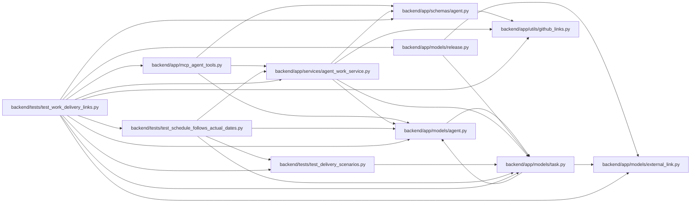

# test_work_delivery_links Module

**Path:** `backend/tests/test_work_delivery_links.py`

## Description

A task records where its code went: branch, commits and pull request, and a release its merge PR or tag.

## Imports

| Source | Symbols |
|--------|---------|
| `app.mcp_agent_tools` | `create_release_github_link` |
| `app.models.agent` | `AgentActor` |
| `app.models.external_link` | `ExternalLink` |
| `app.models.release` | `Release` |
| `app.models.task` | `Task` |
| `app.schemas.agent` | `AgentWorkBegin`, `AgentWorkSubmit`, `ModelAwareAgentWorkBegin` |
| `app.services.agent_work_service` | `AgentConflictError` |
| `app.utils.github_links` | `GitHubLinkError`, `parse_github_url` |
| `datetime` | `date` |
| `pydantic` | `ValidationError` |
| `pytest` | `pytest` |
| `sqlalchemy` | `select` |
| `tests.test_delivery_scenarios` | `delivery_store` |
| `tests.test_schedule_follows_actual_dates` | `_begin_next`, `_client`, `_headers`, `_seed`, `fixed_clock` |

## Local dependency map

<!-- Auto-generated local dependency summary. Do not edit by hand. -->

### Internal neighbors

| Direction | Module |
|---|---|
| Outbound | [mcp_agent_tools](../modules/mcp_agent_tools.md) |
| Outbound | [models_agent](../modules/models_agent.md) |
| Outbound | [models_external_link](../modules/models_external_link.md) |
| Outbound | [models_release](../modules/models_release.md) |
| Outbound | [models_task](../modules/models_task.md) |
| Outbound | [schemas_agent](../modules/schemas_agent.md) |
| Outbound | [agent_work_service](../modules/agent_work_service.md) |
| Outbound | [github_links](../modules/github_links.md) |
| Outbound | [test_delivery_scenarios](../modules/test_delivery_scenarios.md) |
| Outbound | [test_schedule_follows_actual_dates](../modules/test_schedule_follows_actual_dates.md) |

### External packages

| Language | Used packages | Undeclared packages |
|---|---:|---:|
| python | 3 | 1 |

## Functions

| Function | Signature | Decorators | Description |
|----------|-----------|------------|-------------|
| `test_commit_urls_are_normalized_to_one_full_sha_spelling` | `()` | — | — |
| `test_a_short_commit_sha_is_refused` | `()` | — | — |
| `test_release_tags_and_existing_link_kinds_parse` | `()` | — | — |
| `_submit_body` | `(**links)` | — | — |
| `test_begin_accepts_only_a_branch_url` | `()` | — | — |
| `test_submit_commit_urls_must_be_commits_and_repeat_once` | `()` | — | — |
| `_task_links` | *(async)* `(factory, task_id)` | — | — |
| `test_begin_and_submit_link_the_branch_commits_and_pull_request` | *(async)* `(delivery_store, fixed_clock)` | — | — |
| `test_a_submit_without_links_records_none` | *(async)* `(delivery_store, fixed_clock)` | — | — |
| `test_a_pm_links_a_release_to_its_merge_pull_request_and_tag` | *(async)* `(delivery_store)` | — | — |
