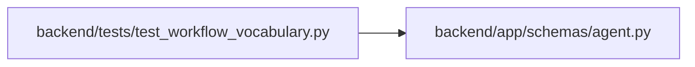

# test_workflow_vocabulary Module

**Path:** `backend/tests/test_workflow_vocabulary.py`

## Description

The shared workflow vocabulary is rendered identically into every role skill.

## Imports

| Source | Symbols |
|--------|---------|
| `__future__` | `annotations` |
| `app.schemas.agent` | `AgentPipelineResponse` |
| `json` | `json` |
| `pathlib` | `Path` |
| `pytest` | `pytest` |
| `scripts` | `build_agent_skills` |
| `shutil` | `shutil` |

## Local dependency map

<!-- Auto-generated local dependency summary. Do not edit by hand. -->

### Internal neighbors

| Direction | Module |
|---|---|
| Outbound | [schemas_agent](../modules/schemas_agent.md) |

### External packages

| Language | Used packages | Undeclared packages |
|---|---:|---:|
| python | 2 | 2 |

## Functions

| Function | Signature | Decorators | Description |
|----------|-----------|------------|-------------|
| `_copy_vocabulary` | `(tmp_path: Path, mutate = None) -> Path` | — | — |
| `test_every_role_carries_the_current_generated_vocabulary` | `() -> None` | — | — |
| `test_vocabulary_names_every_agent_role_once` | `() -> None` | — | — |
| `test_pipeline_response_has_exactly_the_vocabulary_stages_in_order` | `() -> None` | — | — |
| `test_invalid_vocabulary_is_rejected` | `(tmp_path: Path, mutate, message: str) -> None` | `@pytest.mark.parametrize(('mutate', 'message'), [(lambda v: v.update(schema_version='other/v1'), 'Unsupported workflow vocabulary schema'), (lambda v: v['roles'][0]['name'].pop('ru'), 'needs exactly'), (lambda v: v['actions'].append(dict(v['actions'][0])), 'Duplicate workflow vocabulary id'), (lambda v: v['terms'][0].update(means='a \| b'), 'must not contain'), (lambda v: v['queues'][0].update(extra='x'), 'unknown fields'), (lambda v: v.update(stages=[]), 'must contain exactly')])` | — |
| `test_stale_generated_vocabulary_is_rejected` | `(tmp_path: Path) -> None` | — | — |
