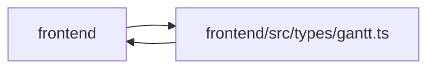

# gantt Module

**Path:** `frontend/src/types/gantt.ts`

## Description

_Auto-generated from `frontend/src/types/gantt.ts`._

## Imports

| Source | Symbols | Type-only | Runtime emission |
|--------|---------|-----------|------------------|
| `./iteration` | `Iteration` | Declaration | erased |
| `./task` | `TaskUpdate` | Declaration | erased |

## Module Signals

| Signal | Values |
|--------|--------|
| Exports | `ExplainScheduleDetailLevel`, `ExplainScheduleRequest`, `ExplainScheduleResponse`, `GanttResponse`, `GanttTask`, `ScheduleDecisionExplanation`, `SchedulePreviewResponse`, `ScheduleResult`, `SchedulingDecision`, `UnscheduledReason`, `UnscheduledTask`, `WorkloadAnalysis`, `WorkloadIssue` |

## Local dependency map

<!-- Auto-generated local dependency summary. Do not edit by hand. -->
This graph shows full source coupling. Type dependencies can be erased; compiler-dependent cycle groups are runtime candidates, not confirmed initialization cycles.

> Module-level dependencies exceed the generated-diagram limits, so the diagram and table below group them by top-level package. Counts report the number of module neighbors in each package.

### Internal neighbors

| Direction | Module |
|---|---|
| Inbound | `frontend` (11) |
| Outbound | `frontend` (2) |

> All 13 module neighbor(s) are summarized by package because the module-level view exceeds the 12-node limit.

## Classes

| Class | Kind | Line | Bases / Target | Description |
|-------|------|------|----------------|-------------|
| [GanttTask](../entities/types_gantt_GanttTask.md) | Interface | 6 | — | — |
| [GanttResponse](../entities/types_gantt_GanttResponse.md) | Interface | 56 | — | — |
| [UnscheduledTask](../entities/types_gantt_UnscheduledTask.md) | Interface | 70 | — | A planned task the scheduler left without dates, with the cause and the server's English hint. |
| [ScheduleResult](../entities/types_gantt_ScheduleResult.md) | Interface | 77 | — | — |
| [SchedulePreviewResponse](../entities/types_gantt_SchedulePreviewResponse.md) | Interface | 88 | — | Server dry-run of sandbox edits through the real scheduler (nothing persisted). |
| [SchedulingDecision](../entities/types_gantt_SchedulingDecision.md) | Interface | 96 | — | — |
| [WorkloadIssue](../entities/types_gantt_WorkloadIssue.md) | Interface | 104 | — | — |
| [ExplainScheduleRequest](../entities/types_gantt_ExplainScheduleRequest.md) | Interface | 112 | — | — |
| [ScheduleDecisionExplanation](../entities/types_gantt_ScheduleDecisionExplanation.md) | Interface | 116 | — | — |
| [WorkloadAnalysis](../entities/types_gantt_WorkloadAnalysis.md) | Interface | 123 | — | — |
| [ExplainScheduleResponse](../entities/types_gantt_ExplainScheduleResponse.md) | Interface | 128 | — | — |
| [UnscheduledReason](../entities/types_gantt_UnscheduledReason.md) | Type alias | 66 | <pre><code>&#39;no&#95;assignee&#39; &#124; &#39;assignee&#95;not&#95;in&#95;iteration&#39; &#124; &#39;no&#95;estimate&#39; &#124; &#39;no&#95;capacity&#39;&#10;    &#124; &#39;prerequisites&#95;pending&#39; &#124; &#39;predecessor&#95;unscheduled&#39; &#124; &#39;deferred&#39; &#124; &#39;blocked&#39; &#124; &#39;not&#95;placed&#39;</code></pre> | — |
| [ExplainScheduleDetailLevel](../entities/ExplainScheduleDetailLevel.md) | Type alias | 110 | `'brief' \| 'full'` | — |
