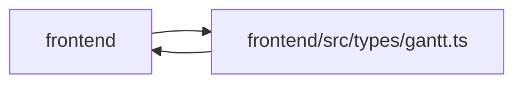

# gantt Module

**Path:** `frontend/src/types/gantt.ts`

## Description

_Auto-generated from `frontend/src/types/gantt.ts`._

## Imports

| Source | Symbols | Type-only | Runtime emission |
|--------|---------|-----------|------------------|
| `./iteration` | `Iteration` | Declaration | erased |
| `./task` | `TaskUpdate` | Declaration | erased |

## Module Signals

| Signal | Values |
|--------|--------|
| Exports | `ExplainScheduleDetailLevel`, `ExplainScheduleRequest`, `ExplainScheduleResponse`, `GanttResponse`, `GanttTask`, `ScheduleDecisionExplanation`, `SchedulePreviewResponse`, `ScheduleResult`, `SchedulingDecision`, `WorkloadAnalysis`, `WorkloadIssue` |

## Local dependency map

<!-- Auto-generated local dependency summary. Do not edit by hand. -->
This graph shows full source coupling. Type dependencies can be erased; compiler-dependent cycle groups are runtime candidates, not confirmed initialization cycles.

> Module-level dependencies exceed the generated-diagram limits, so the diagram and table below group them by top-level package. Counts report the number of module neighbors in each package.

### Internal neighbors

| Direction | Module |
|---|---|
| Inbound | `frontend` (10) |
| Outbound | `frontend` (2) |

> All 12 module neighbor(s) are summarized by package because the module-level view exceeds the 12-node limit.

## Classes

| Class | Kind | Line | Bases / Target | Description |
|-------|------|------|----------------|-------------|
| [GanttTask](../entities/types_gantt_GanttTask.md) | Interface | 6 | — | — |
| [GanttResponse](../entities/types_gantt_GanttResponse.md) | Interface | 56 | — | — |
| [ScheduleResult](../entities/types_gantt_ScheduleResult.md) | Interface | 66 | — | — |
| [SchedulePreviewResponse](../entities/types_gantt_SchedulePreviewResponse.md) | Interface | 76 | — | Server dry-run of sandbox edits through the real scheduler (nothing persisted). |
| [SchedulingDecision](../entities/types_gantt_SchedulingDecision.md) | Interface | 84 | — | — |
| [WorkloadIssue](../entities/types_gantt_WorkloadIssue.md) | Interface | 92 | — | — |
| [ExplainScheduleRequest](../entities/types_gantt_ExplainScheduleRequest.md) | Interface | 100 | — | — |
| [ScheduleDecisionExplanation](../entities/types_gantt_ScheduleDecisionExplanation.md) | Interface | 104 | — | — |
| [WorkloadAnalysis](../entities/types_gantt_WorkloadAnalysis.md) | Interface | 111 | — | — |
| [ExplainScheduleResponse](../entities/types_gantt_ExplainScheduleResponse.md) | Interface | 116 | — | — |
| [ExplainScheduleDetailLevel](../entities/ExplainScheduleDetailLevel.md) | Type alias | 98 | `'brief' \| 'full'` | — |
