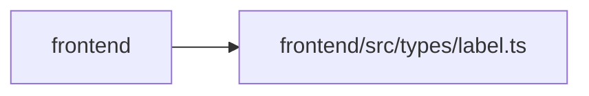

# label Module

**Path:** `frontend/src/types/label.ts`

## Description

_Auto-generated from `frontend/src/types/label.ts`._

## Module Signals

| Signal | Values |
|--------|--------|
| Exports | `Label`, `LabelCreate`, `LabelGroup`, `LabelGroupBrief`, `LabelGroupCreate`, `LabelGroupListParams`, `LabelGroupUpdate`, `LabelListParams`, `LabelUpdate` |

## Local dependency map

<!-- Auto-generated local dependency summary. Do not edit by hand. -->
This graph shows full source coupling. Type dependencies can be erased; compiler-dependent cycle groups are runtime candidates, not confirmed initialization cycles.

> Module-level dependencies exceed the generated-diagram limits, so the diagram and table below group them by top-level package. Counts report the number of module neighbors in each package.

### Internal neighbors

| Direction | Module |
|---|---|
| Inbound | `frontend` (12) |

> All 12 module neighbor(s) are summarized by package because the module-level view exceeds the 12-node limit.

## Classes

| Class | Kind | Line | Bases / Target | Description |
|-------|------|------|----------------|-------------|
| [LabelGroupBrief](../entities/types_label_LabelGroupBrief.md) | Interface | 1 | — | — |
| [Label](../entities/types_label_Label.md) | Interface | 9 | — | — |
| [LabelGroup](../entities/types_label_LabelGroup.md) | Interface | 24 | — | — |
| [LabelGroupCreate](../entities/types_label_LabelGroupCreate.md) | Interface | 38 | — | — |
| [LabelCreate](../entities/types_label_LabelCreate.md) | Interface | 49 | — | — |
| [LabelGroupListParams](../entities/LabelGroupListParams.md) | Interface | 61 | — | — |
| [LabelListParams](../entities/LabelListParams.md) | Interface | 65 | — | — |
| [LabelGroupUpdate](../entities/types_label_LabelGroupUpdate.md) | Type alias | 47 | `Partial<LabelGroupCreate>` | — |
| [LabelUpdate](../entities/types_label_LabelUpdate.md) | Type alias | 59 | `Partial<LabelCreate>` | — |
