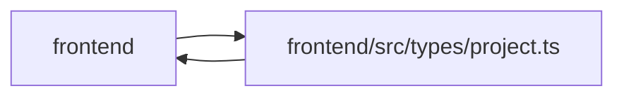

# project Module

**Path:** `frontend/src/types/project.ts`

## Description

_Auto-generated from `frontend/src/types/project.ts`._

## Imports

| Source | Symbols | Type-only | Runtime emission |
|--------|---------|-----------|------------------|
| `./task` | `Task` | Declaration | erased |
| `./team` | `TeamMemberOption`, `TeamMemberProfileCompact` | Declaration | erased |
| `./workMetrics` | `WorkMetrics` | Declaration | erased |

## Module Signals

| Signal | Values |
|--------|--------|
| Exports | `Initiative`, `InitiativeCreate`, `InitiativeUpdate`, `Project`, `ProjectCreate`, `ProjectHealth`, `ProjectInitiativeSummary`, `ProjectMilestone`, `ProjectMilestoneCreateRequest`, `ProjectMilestoneDeleteResponse`, `ProjectMilestoneStatus`, `ProjectMilestoneSummary`, `ProjectMilestoneTaskGroup`, `ProjectMilestoneUpdateRequest`, `ProjectOwner`, `ProjectPortfolioSummary`, `ProjectProfileOwner`, `ProjectStatus`, `ProjectSummary`, `ProjectTargetDateRisk`, `ProjectTask`, `ProjectUpdate`, `ProjectUpdateEntry`, `ProjectUpdateEntryCreate`, `ProjectUpdateFreshness`, `RoadmapMilestonePage` |

## Local dependency map

<!-- Auto-generated local dependency summary. Do not edit by hand. -->
This graph shows full source coupling. Type dependencies can be erased; compiler-dependent cycle groups are runtime candidates, not confirmed initialization cycles.

> Module-level dependencies exceed the generated-diagram limits, so the diagram and table below group them by top-level package. Counts report the number of module neighbors in each package.

### Internal neighbors

| Direction | Module |
|---|---|
| Inbound | `frontend` (10) |
| Outbound | `frontend` (3) |

> All 13 module neighbor(s) are summarized by package because the module-level view exceeds the 12-node limit.

## Classes

| Class | Kind | Line | Bases / Target | Description |
|-------|------|------|----------------|-------------|
| [Initiative](../entities/types_project_Initiative.md) | Interface | 13 | — | — |
| [InitiativeCreate](../entities/types_project_InitiativeCreate.md) | Interface | 27 | — | — |
| [InitiativeUpdate](../entities/types_project_InitiativeUpdate.md) | Interface | 36 | — | — |
| [ProjectInitiativeSummary](../entities/types_project_ProjectInitiativeSummary.md) | Interface | 45 | — | — |
| [Project](../entities/types_project_Project.md) | Interface | 56 | — | — |
| [ProjectCreate](../entities/types_project_ProjectCreate.md) | Interface | 76 | — | — |
| [ProjectUpdate](../entities/types_project_ProjectUpdate.md) | Interface | 89 | — | — |
| [ProjectUpdateEntry](../entities/types_project_ProjectUpdateEntry.md) | Interface | 103 | — | — |
| [ProjectUpdateEntryCreate](../entities/types_project_ProjectUpdateEntryCreate.md) | Interface | 116 | — | — |
| [ProjectMilestone](../entities/types_project_ProjectMilestone.md) | Interface | 125 | — | — |
| [RoadmapMilestonePage](../entities/types_project_RoadmapMilestonePage.md) | Interface | 138 | — | — |
| [ProjectMilestoneCreateRequest](../entities/types_project_ProjectMilestoneCreateRequest.md) | Interface | 143 | — | — |
| [ProjectMilestoneUpdateRequest](../entities/ProjectMilestoneUpdateRequest.md) | Interface | 152 | — | — |
| [ProjectMilestoneDeleteResponse](../entities/types_project_ProjectMilestoneDeleteResponse.md) | Interface | 161 | — | — |
| [ProjectMilestoneSummary](../entities/types_project_ProjectMilestoneSummary.md) | Interface | 167 | — | — |
| [ProjectMilestoneTaskGroup](../entities/types_project_ProjectMilestoneTaskGroup.md) | Interface | 176 | — | — |
| [ProjectPortfolioSummary](../entities/types_project_ProjectPortfolioSummary.md) | Interface | 188 | `WorkMetrics` | — |
| [ProjectSummary](../entities/types_project_ProjectSummary.md) | Interface | 199 | `WorkMetrics` | — |
| [ProjectStatus](../entities/types_project_ProjectStatus.md) | Type alias | 5 | `'proposed' \| 'planned' \| 'active' \| 'paused' \| 'completed' \| 'canceled'` | — |
| [ProjectHealth](../entities/types_project_ProjectHealth.md) | Type alias | 6 | `'unknown' \| 'on_track' \| 'at_risk' \| 'off_track'` | — |
| [ProjectTargetDateRisk](../entities/types_project_ProjectTargetDateRisk.md) | Type alias | 7 | `'unknown' \| 'on_track' \| 'at_risk' \| 'off_track'` | — |
| [ProjectUpdateFreshness](../entities/types_project_ProjectUpdateFreshness.md) | Type alias | 8 | `'fresh' \| 'stale' \| 'missing' \| 'not_required'` | — |
| [ProjectMilestoneStatus](../entities/types_project_ProjectMilestoneStatus.md) | Type alias | 9 | `'planned' \| 'active' \| 'completed' \| 'canceled'` | — |
| [ProjectOwner](../entities/ProjectOwner.md) | Type alias | 10 | `TeamMemberOption` | — |
| [ProjectProfileOwner](../entities/ProjectProfileOwner.md) | Type alias | 11 | `TeamMemberProfileCompact` | — |
| [ProjectTask](../entities/ProjectTask.md) | Type alias | 237 | `Task` | — |
