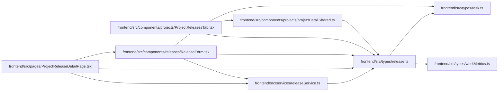

# release Module

**Path:** `frontend/src/types/release.ts`

## Description

_Auto-generated from `frontend/src/types/release.ts`._

## Imports

| Source | Symbols | Type-only | Runtime emission |
|--------|---------|-----------|------------------|
| `./task` | `TaskDisplayedState`, `TaskStatus` | Declaration | erased |
| `./workMetrics` | `WorkMetrics` | Declaration | erased |

## Module Signals

| Signal | Values |
|--------|--------|
| Exports | `Release`, `ReleaseCreateRequest`, `ReleaseStatus`, `ReleaseTaskSummary`, `ReleaseUpdateRequest` |

## Local dependency map

<!-- Auto-generated local dependency summary. Do not edit by hand. -->
This graph shows full source coupling. Type dependencies can be erased; compiler-dependent cycle groups are runtime candidates, not confirmed initialization cycles.

### Internal neighbors

| Direction | Module |
|---|---|
| Inbound | [projectDetailShared](../modules/projectDetailShared.md) |
| Inbound | [ProjectReleasesTab](../modules/ProjectReleasesTab.md) |
| Inbound | [ReleaseForm](../modules/ReleaseForm.md) |
| Inbound | [ProjectReleaseDetailPage](../modules/ProjectReleaseDetailPage.md) |
| Inbound | [releaseService](../modules/releaseService.md) |
| Outbound | [types_task](../modules/types_task.md) |
| Outbound | [workMetrics](../modules/workMetrics.md) |

## Classes

| Class | Kind | Line | Bases / Target | Description |
|-------|------|------|----------------|-------------|
| [ReleaseTaskSummary](../entities/types_release_ReleaseTaskSummary.md) | Interface | 6 | — | — |
| [Release](../entities/types_release_Release.md) | Interface | 14 | `WorkMetrics` | — |
| [ReleaseCreateRequest](../entities/types_release_ReleaseCreateRequest.md) | Interface | 30 | — | — |
| [ReleaseUpdateRequest](../entities/types_release_ReleaseUpdateRequest.md) | Interface | 41 | — | — |
| [ReleaseStatus](../entities/types_release_ReleaseStatus.md) | Type alias | 4 | `'planned' \| 'building' \| 'shipped' \| 'canceled'` | — |
