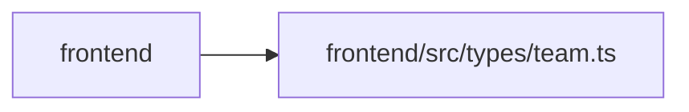

# team Module

**Path:** `frontend/src/types/team.ts`

## Description

_Auto-generated from `frontend/src/types/team.ts`._

## Module Signals

| Signal | Values |
|--------|--------|
| Exports | `AssigneeRecommendation`, `MemberCapacity`, `MemberWorkload`, `TeamMember`, `TeamMemberAssignmentMode`, `TeamMemberCreate`, `TeamMemberOption`, `TeamMemberProfile`, `TeamMemberProfileCompact`, `TeamMemberProfileCreate`, `TeamMemberProfileKind`, `TeamMemberProfileSkill`, `TeamMemberProfileSkillCreate`, `TeamMemberProfileSkillUpdate`, `TeamMemberProfileUpdate`, `Vacation`, `VacationCreate`, `VacationImportError`, `VacationImportResponse` |

## Local dependency map

<!-- Auto-generated local dependency summary. Do not edit by hand. -->
This graph shows full source coupling. Type dependencies can be erased; compiler-dependent cycle groups are runtime candidates, not confirmed initialization cycles.

> Module-level dependencies exceed the generated-diagram limits, so the diagram and table below group them by top-level package. Counts report the number of module neighbors in each package.

### Internal neighbors

| Direction | Module |
|---|---|
| Inbound | `frontend` (22) |

> All 22 module neighbor(s) are summarized by package because the module-level view exceeds the 12-node limit.

## Classes

| Class | Kind | Line | Bases / Target | Description |
|-------|------|------|----------------|-------------|
| [Vacation](../entities/types_team_Vacation.md) | Interface | 1 | — | — |
| [VacationCreate](../entities/types_team_VacationCreate.md) | Interface | 7 | — | — |
| [VacationImportError](../entities/types_team_VacationImportError.md) | Interface | 12 | — | — |
| [VacationImportResponse](../entities/types_team_VacationImportResponse.md) | Interface | 17 | — | — |
| [TeamMemberProfileSkill](../entities/types_team_TeamMemberProfileSkill.md) | Interface | 24 | — | — |
| [TeamMemberProfileSkillCreate](../entities/types_team_TeamMemberProfileSkillCreate.md) | Interface | 39 | — | — |
| [TeamMemberProfile](../entities/types_team_TeamMemberProfile.md) | Interface | 60 | — | — |
| [TeamMemberProfileCompact](../entities/types_team_TeamMemberProfileCompact.md) | Interface | 76 | — | — |
| [TeamMemberProfileCreate](../entities/types_team_TeamMemberProfileCreate.md) | Interface | 87 | — | — |
| [TeamMemberProfileUpdate](../entities/types_team_TeamMemberProfileUpdate.md) | Interface | 99 | — | — |
| [TeamMember](../entities/types_team_TeamMember.md) | Interface | 110 | — | — |
| [TeamMemberOption](../entities/TeamMemberOption.md) | Interface | 124 | — | — |
| [TeamMemberCreate](../entities/types_team_TeamMemberCreate.md) | Interface | 133 | — | — |
| [MemberWorkload](../entities/types_team_MemberWorkload.md) | Interface | 143 | — | — |
| [MemberCapacity](../entities/types_team_MemberCapacity.md) | Interface | 159 | — | Detailed capacity breakdown from GET /team-members/{id}/capacity. |
| [AssigneeRecommendation](../entities/AssigneeRecommendation.md) | Interface | 169 | — | — |
| [TeamMemberProfileSkillUpdate](../entities/types_team_TeamMemberProfileSkillUpdate.md) | Type alias | 50 | `Partial<TeamMemberProfileSkillCreate>` | — |
| [TeamMemberProfileKind](../entities/TeamMemberProfileKind.md) | Type alias | 52 | `'human' \| 'agent' \| 'hybrid'` | — |
| [TeamMemberAssignmentMode](../entities/TeamMemberAssignmentMode.md) | Type alias | 54 | <pre><code>&#124; &#39;ownership&#39;&#10;    &#124; &#39;execution&#39;&#10;    &#124; &#39;verification&#39;&#10;    &#124; &#39;design&#95;handoff&#39;</code></pre> | — |
