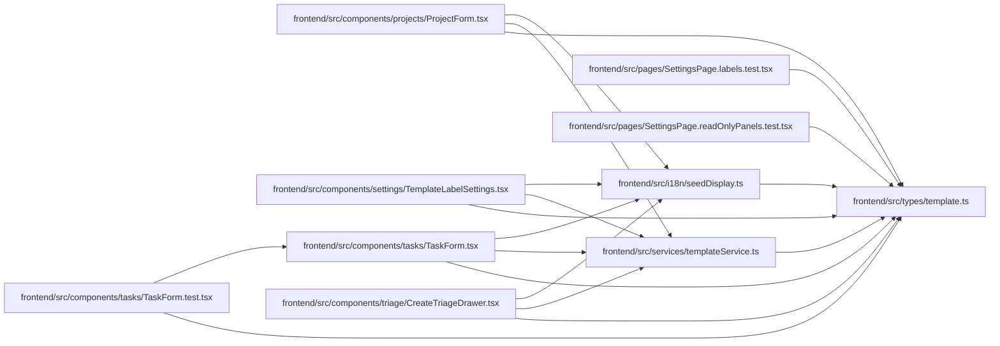

# template Module

**Path:** `frontend/src/types/template.ts`

## Description

_Auto-generated from `frontend/src/types/template.ts`._

## Module Signals

| Signal | Values |
|--------|--------|
| Exports | `TemplateListParams`, `TemplateType`, `WorkTemplate`, `WorkTemplateCreate`, `WorkTemplateUpdate` |

## Local dependency map

<!-- Auto-generated local dependency summary. Do not edit by hand. -->
This graph shows full source coupling. Type dependencies can be erased; compiler-dependent cycle groups are runtime candidates, not confirmed initialization cycles.

### Internal neighbors

| Direction | Module |
|---|---|
| Inbound | [ProjectForm](../modules/ProjectForm.md) |
| Inbound | [TemplateLabelSettings](../modules/TemplateLabelSettings.md) |
| Inbound | [TaskForm.test](../modules/TaskForm.test.md) |
| Inbound | [TaskForm](../modules/TaskForm.md) |
| Inbound | [CreateTriageDrawer](../modules/CreateTriageDrawer.md) |
| Inbound | [seedDisplay](../modules/seedDisplay.md) |
| Inbound | [SettingsPage.labels.test](../modules/SettingsPage.labels.test.md) |
| Inbound | [SettingsPage.readOnlyPanels.test](../modules/SettingsPage.readOnlyPanels.test.md) |
| Inbound | [templateService](../modules/templateService.md) |

## Classes

| Class | Kind | Line | Bases / Target | Description |
|-------|------|------|----------------|-------------|
| [WorkTemplate](../entities/types_template_WorkTemplate.md) | Interface | 3 | — | — |
| [WorkTemplateCreate](../entities/types_template_WorkTemplateCreate.md) | Interface | 22 | — | — |
| [TemplateListParams](../entities/TemplateListParams.md) | Interface | 39 | — | — |
| [TemplateType](../entities/types_template_TemplateType.md) | Type alias | 1 | `'task' \| 'project' \| 'triage'` | — |
| [WorkTemplateUpdate](../entities/types_template_WorkTemplateUpdate.md) | Type alias | 37 | `Partial<WorkTemplateCreate>` | — |
