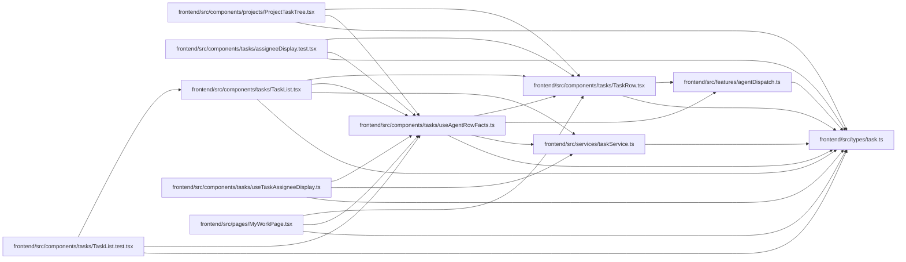

# useAgentRowFacts Module

**Path:** `frontend/src/components/tasks/useAgentRowFacts.ts`

## Description

_Auto-generated from `frontend/src/components/tasks/useAgentRowFacts.ts`._

## Imports

| Source | Symbols | Type-only | Runtime emission |
|--------|---------|-----------|------------------|
| `../../features/agentDispatch` | `AgentDispatchState` | Declaration | erased |
| `../../features/agentDispatch` | `taskAgentDispatchState` | — | compiler-dependent |
| `../../services/taskService` | `taskService` | — | compiler-dependent |
| `../../types/task` | `Task`, `TaskStatus` | Declaration | erased |
| `./TaskRow` | `TaskRowAssigneeOption` | Declaration | erased |
| `@tanstack/react-query` | `useQueries` | — | compiler-dependent |
| `react` | `useMemo` | — | compiler-dependent |

## Module Signals

| Signal | Values |
|--------|--------|
| Exports | `AgentRowFacts`, `DisplayedTask`, `REVIEWER_PAGE_SIZE`, `agentRowValues`, `assigneeKind`, `useAgentRowFacts` |
| Constants | `REVIEWER_PAGE_SIZE` |

## Local dependency map

<!-- Auto-generated local dependency summary. Do not edit by hand. -->
This graph shows full source coupling. Type dependencies can be erased; compiler-dependent cycle groups are runtime candidates, not confirmed initialization cycles.

### Internal neighbors

| Direction | Module |
|---|---|
| Inbound | [ProjectTaskTree](../modules/ProjectTaskTree.md) |
| Inbound | [assigneeDisplay.test](../modules/assigneeDisplay.test.md) |
| Inbound | [TaskList.test](../modules/TaskList.test.md) |
| Inbound | [TaskList](../modules/TaskList.md) |
| Inbound | [useTaskAssigneeDisplay](../modules/useTaskAssigneeDisplay.md) |
| Inbound | [MyWorkPage](../modules/MyWorkPage.md) |
| Outbound | [TaskRow](../modules/TaskRow.md) |
| Outbound | [agentDispatch](../modules/agentDispatch.md) |
| Outbound | [taskService](../modules/taskService.md) |
| Outbound | [types_task](../modules/types_task.md) |

### External packages

| Language | Used packages | Undeclared packages |
|---|---:|---:|
| typescript | 2 | 0 |

## Classes

| Class | Kind | Line | Bases / Target | Description |
|-------|------|------|----------------|-------------|
| [DisplayedTask](../entities/DisplayedTask.md) | Interface | 13 | — | A row the page shows: only its id and status decide whether a Reviewer is read for it. |
| [AgentRowFacts](../entities/AgentRowFacts.md) | Interface | 15 | — | — |

## Functions

| Function | Signature | Decorators | Description |
|----------|-----------|------------|-------------|
| `useAgentRowFacts` | `(tasks: DisplayedTask[], known?: ReadonlyMap<number, string \| null>) -> AgentRowFacts` | — | What a task row needs beside the task to show the agent status line and the Reviewer. |
| `assigneeKind` | `(assignee: { id: number; kind?: TaskRowAssigneeOption['kind'] \| null } \| null \| undefined, option: TaskRowAssigneeOption \| undefined) -> TaskRowAssigneeOption['kind']` | — | The kind of a task's assignee: from the team read once it has the assignee's row, otherwise |
| `agentRowValues` | `(task: Pick<Task, 'id' \| 'status' \| 'agent_working' \| 'claimed_by'> & { assignee?: { id: number; kind?: TaskRowAssigneeOption['kind'] \| null } \| null }, options: TaskRowAssigneeOption[] \| undefined, facts: AgentRowFacts) -> { dispatch: AgentDispatchState \| null; reviewer: { name: string \| null } \| null \| undefined }` | — | The agent status line and the Reviewer for one row. The status line is for an agent |
