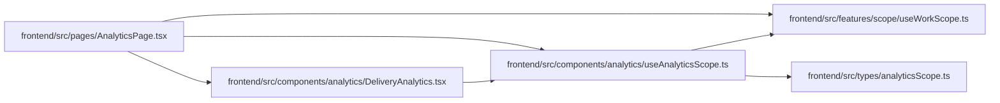

# useAnalyticsScope Module

**Path:** `frontend/src/components/analytics/useAnalyticsScope.ts`

## Description

_Auto-generated from `frontend/src/components/analytics/useAnalyticsScope.ts`._

## Imports

| Source | Symbols | Type-only | Runtime emission |
|--------|---------|-----------|------------------|
| `../../features/scope/useWorkScope` | `useWorkScope` | — | compiler-dependent |
| `../../types/analyticsScope` | `AnalyticsScope` | Declaration | erased |

## Module Signals

| Signal | Values |
|--------|--------|
| Exports | `useAnalyticsScope` |

## Local dependency map

<!-- Auto-generated local dependency summary. Do not edit by hand. -->
This graph shows full source coupling. Type dependencies can be erased; compiler-dependent cycle groups are runtime candidates, not confirmed initialization cycles.

### Internal neighbors

| Direction | Module |
|---|---|
| Inbound | [DeliveryAnalytics](../modules/DeliveryAnalytics.md) |
| Inbound | [AnalyticsPage](../modules/AnalyticsPage.md) |
| Outbound | [useWorkScope](../modules/useWorkScope.md) |
| Outbound | [analyticsScope](../modules/analyticsScope.md) |

## Functions

| Function | Signature | Decorators | Description |
|----------|-----------|------------|-------------|
| `useAnalyticsScope` | `(days: number) -> AnalyticsScope \| undefined` | — | — |
