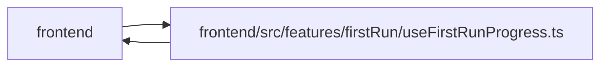

# useFirstRunProgress Module

**Path:** `frontend/src/features/firstRun/useFirstRunProgress.ts`

## Description

_Auto-generated from `frontend/src/features/firstRun/useFirstRunProgress.ts`._

## Imports

| Source | Symbols | Type-only | Runtime emission |
|--------|---------|-----------|------------------|
| `../../services/iterationService` | `iterationService` | — | compiler-dependent |
| `../../services/projectService` | `projectService` | — | compiler-dependent |
| `../../types/iteration` | `Iteration` | Declaration | erased |
| `../identity/identityContext` | `useIdentity` | — | compiler-dependent |
| `../planningMasters/usePlanningNavigationSummary` | `planningNavigationSummaryKey` | — | compiler-dependent |
| `../scope/workScope` | `pickDefaultIteration` | — | compiler-dependent |
| `./firstRunSteps` | `FirstRunFacts`, `FirstRunStep`, `FirstRunStepId` | Specifier | compiler-dependent |
| `./firstRunSteps` | `firstRunSteps`, `nextFirstRunStep` | — | compiler-dependent |
| `@tanstack/react-query` | `useQuery` | — | compiler-dependent |
| `react` | `useMemo` | — | compiler-dependent |

## Module Signals

| Signal | Values |
|--------|--------|
| Exports | `FirstRunProgress`, `useFirstRunProgress` |

## Local dependency map

<!-- Auto-generated local dependency summary. Do not edit by hand. -->
This graph shows full source coupling. Type dependencies can be erased; compiler-dependent cycle groups are runtime candidates, not confirmed initialization cycles.

> Module-level dependencies exceed the generated-diagram limits, so the diagram and table below group them by top-level package. Counts report the number of module neighbors in each package.

### Internal neighbors

| Direction | Module |
|---|---|
| Inbound | `frontend` (6) |
| Outbound | `frontend` (7) |

### External packages

| Language | Used packages | Undeclared packages |
|---|---:|---:|
| typescript | 2 | 0 |

> All 13 module neighbor(s) are summarized by package because the module-level view exceeds the 12-node limit.

## Classes

| Class | Kind | Line | Bases / Target | Description |
|-------|------|------|----------------|-------------|
| [FirstRunProgress](../entities/FirstRunProgress.md) | Interface | 11 | — | — |

## Functions

| Function | Signature | Decorators | Description |
|----------|-----------|------------|-------------|
| `useFirstRunProgress` | `() -> FirstRunProgress` | — | How far the workspace is set up, from the data alone: the chosen profile, the projects, the |
