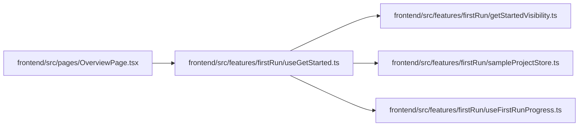

# useGetStarted Module

**Path:** `frontend/src/features/firstRun/useGetStarted.ts`

## Description

_Auto-generated from `frontend/src/features/firstRun/useGetStarted.ts`._

## Imports

| Source | Symbols | Type-only | Runtime emission |
|--------|---------|-----------|------------------|
| `./getStartedVisibility` | `useGetStartedVisibility` | — | compiler-dependent |
| `./sampleProjectStore` | `useSampleProject` | — | compiler-dependent |
| `./useFirstRunProgress` | `useFirstRunProgress` | — | compiler-dependent |
| `react` | `useEffect` | — | compiler-dependent |

## Module Signals

| Signal | Values |
|--------|--------|
| Exports | `useGetStarted` |

## Local dependency map

<!-- Auto-generated local dependency summary. Do not edit by hand. -->

### Internal neighbors

| Direction | Module |
|---|---|
| Inbound | [OverviewPage](../modules/OverviewPage.md) |
| Outbound | [getStartedVisibility](../modules/getStartedVisibility.md) |
| Outbound | [sampleProjectStore](../modules/sampleProjectStore.md) |
| Outbound | [useFirstRunProgress](../modules/useFirstRunProgress.md) |

### External packages

| Language | Used packages | Undeclared packages |
|---|---:|---:|
| typescript | 1 | 0 |

## Functions

| Function | Signature | Decorators | Description |
|----------|-----------|------------|-------------|
| `useGetStarted` | `()` | — | Whether Overview shows the Get started panel: once every step's state is known, while setup |
