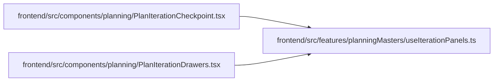

# useIterationPanels Module

**Path:** `frontend/src/features/planningMasters/useIterationPanels.ts`

## Description

_Auto-generated from `frontend/src/features/planningMasters/useIterationPanels.ts`._

## Imports

| Source | Symbols | Type-only | Runtime emission |
|--------|---------|-----------|------------------|
| `react` | `useCallback` | — | compiler-dependent |
| `react-router-dom` | `useSearchParams` | — | compiler-dependent |

## Module Signals

| Signal | Values |
|--------|--------|
| Exports | `useIterationPanels` |
| Constants | `PANEL_PARAM`, `LIST_PANEL`, `CREATE_PARAM`, `EDIT_PARAM` |

## Local dependency map

<!-- Auto-generated local dependency summary. Do not edit by hand. -->

### Internal neighbors

| Direction | Module |
|---|---|
| Inbound | [PlanIterationCheckpoint](../modules/PlanIterationCheckpoint.md) |
| Inbound | [PlanIterationDrawers](../modules/PlanIterationDrawers.md) |

### External packages

| Language | Used packages | Undeclared packages |
|---|---:|---:|
| typescript | 2 | 0 |

## Functions

| Function | Signature | Decorators | Description |
|----------|-----------|------------|-------------|
| `useIterationPanels` | `()` | — | The iteration drawers on Plan live in the link, so Back closes them and a link can open them: |
