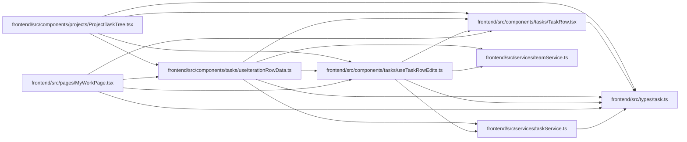

# useIterationRowData Module

**Path:** `frontend/src/components/tasks/useIterationRowData.ts`

## Description

_Auto-generated from `frontend/src/components/tasks/useIterationRowData.ts`._

## Imports

| Source | Symbols | Type-only | Runtime emission |
|--------|---------|-----------|------------------|
| `../../services/taskService` | `taskService` | — | compiler-dependent |
| `../../services/teamService` | `teamService` | — | compiler-dependent |
| `../../types/task` | `Task` | Declaration | erased |
| `./TaskRow` | `TaskRowAssigneeOption` | Declaration | erased |
| `./useTaskRowEdits` | `assigneeOptionsFrom` | — | compiler-dependent |
| `@tanstack/react-query` | `useQueries` | — | compiler-dependent |
| `react` | `useMemo` | — | compiler-dependent |

## Module Signals

| Signal | Values |
|--------|--------|
| Exports | `useIterationRowData` |

## Local dependency map

<!-- Auto-generated local dependency summary. Do not edit by hand. -->
This graph shows full source coupling. Type dependencies can be erased; compiler-dependent cycle groups are runtime candidates, not confirmed initialization cycles.

### Internal neighbors

| Direction | Module |
|---|---|
| Inbound | [ProjectTaskTree](../modules/ProjectTaskTree.md) |
| Inbound | [MyWorkPage](../modules/MyWorkPage.md) |
| Outbound | [TaskRow](../modules/TaskRow.md) |
| Outbound | [useTaskRowEdits](../modules/useTaskRowEdits.md) |
| Outbound | [taskService](../modules/taskService.md) |
| Outbound | [teamService](../modules/teamService.md) |
| Outbound | [types_task](../modules/types_task.md) |

### External packages

| Language | Used packages | Undeclared packages |
|---|---:|---:|
| typescript | 2 | 0 |

## Functions

| Function | Signature | Decorators | Description |
|----------|-----------|------------|-------------|
| `useIterationRowData` | `(iterationIds: (number \| null \| undefined)[], { loadTasks = true }: { loadTasks?: boolean } = {})` | — | What rows of several iterations need that a task reference does not carry, loaded the way the |
