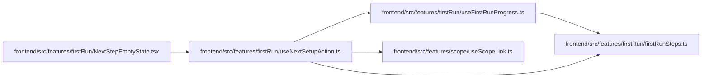

# useNextSetupAction Module

**Path:** `frontend/src/features/firstRun/useNextSetupAction.ts`

## Description

_Auto-generated from `frontend/src/features/firstRun/useNextSetupAction.ts`._

## Imports

| Source | Symbols | Type-only | Runtime emission |
|--------|---------|-----------|------------------|
| `../scope/useScopeLink` | `useScopeLink` | — | compiler-dependent |
| `./firstRunSteps` | `FIRST_RUN_PLAN_CHECKPOINT`, `firstRunPlanHref` | — | compiler-dependent |
| `./useFirstRunProgress` | `useFirstRunProgress` | — | compiler-dependent |
| `react-i18next` | `useTranslation` | — | compiler-dependent |

## Module Signals

| Signal | Values |
|--------|--------|
| Exports | `NextAction`, `useNextSetupAction` |

## Local dependency map

<!-- Auto-generated local dependency summary. Do not edit by hand. -->
This graph shows full source coupling. Type dependencies can be erased; compiler-dependent cycle groups are runtime candidates, not confirmed initialization cycles.

### Internal neighbors

| Direction | Module |
|---|---|
| Inbound | [NextStepEmptyState](../modules/NextStepEmptyState.md) |
| Outbound | [firstRunSteps](../modules/firstRunSteps.md) |
| Outbound | [useFirstRunProgress](../modules/useFirstRunProgress.md) |
| Outbound | [useScopeLink](../modules/useScopeLink.md) |

### External packages

| Language | Used packages | Undeclared packages |
|---|---:|---:|
| typescript | 1 | 0 |

## Classes

| Class | Kind | Line | Bases / Target | Description |
|-------|------|------|----------------|-------------|
| [NextAction](../entities/NextAction.md) | Type alias | 6 | `{ label: string; to: string } \| { label: string; onClick: () => void }` | — |

## Functions

| Function | Signature | Decorators | Description |
|----------|-----------|------------|-------------|
| `useNextSetupAction` | <pre><code>&#40;&#123; fallback&#44; onCreateProject &#125;&#58; &#123;&#10;    fallback&#58; NextAction&#59;&#10;    &#47;&#42;&#42; Opens the project form in place&#44; when the page can&#46; Otherwise the project step opens Projects&#46; &#42;&#47;&#10;    onCreateProject&#63;&#58; &#40;&#41; &#61;&#62; void&#59;&#10;&#125;&#41; &#45;&#62; NextAction</code></pre> | — | The one button an empty page offers: the first setup step not yet done, in the order Get |
