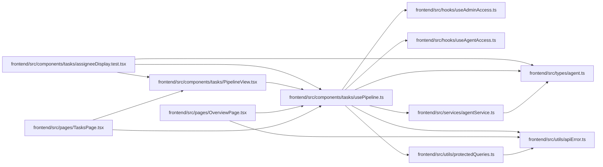

# usePipeline Module

**Path:** `frontend/src/components/tasks/usePipeline.ts`

## Description

_Auto-generated from `frontend/src/components/tasks/usePipeline.ts`._

## Imports

| Source | Symbols | Type-only | Runtime emission |
|--------|---------|-----------|------------------|
| `../../hooks/useAdminAccess` | `useAdminAccess`, `useKeylessReader` | — | compiler-dependent |
| `../../hooks/useAgentAccess` | `useAgentAccess` | — | compiler-dependent |
| `../../services/agentService` | `agentService` | — | compiler-dependent |
| `../../types/agent` | `AgentPipeline` | Declaration | erased |
| `../../utils/apiError` | `getApiErrorStatus` | — | compiler-dependent |
| `../../utils/protectedQueries` | `protectedQueryRetry` | — | compiler-dependent |
| `@tanstack/react-query` | `useQuery` | — | compiler-dependent |
| `react` | `useMemo` | — | compiler-dependent |

## Module Signals

| Signal | Values |
|--------|--------|
| Exports | `usePipeline` |
| Constants | `EMPTY_PIPELINE` |

## Local dependency map

<!-- Auto-generated local dependency summary. Do not edit by hand. -->
This graph shows full source coupling. Type dependencies can be erased; compiler-dependent cycle groups are runtime candidates, not confirmed initialization cycles.

### Internal neighbors

| Direction | Module |
|---|---|
| Inbound | [assigneeDisplay.test](../modules/assigneeDisplay.test.md) |
| Inbound | [PipelineView](../modules/PipelineView.md) |
| Inbound | [OverviewPage](../modules/OverviewPage.md) |
| Inbound | [TasksPage](../modules/TasksPage.md) |
| Outbound | [useAdminAccess](../modules/useAdminAccess.md) |
| Outbound | [useAgentAccess](../modules/useAgentAccess.md) |
| Outbound | [agentService](../modules/agentService.md) |
| Outbound | [types_agent](../modules/types_agent.md) |
| Outbound | [apiError](../modules/apiError.md) |
| Outbound | [protectedQueries](../modules/protectedQueries.md) |

### External packages

| Language | Used packages | Undeclared packages |
|---|---:|---:|
| typescript | 2 | 0 |

## Functions

| Function | Signature | Decorators | Description |
|----------|-----------|------------|-------------|
| `usePipeline` | `(enabled: boolean)` | — | — |
