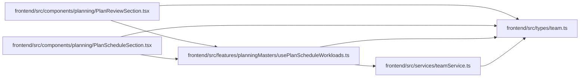

# usePlanScheduleWorkloads Module

**Path:** `frontend/src/features/planningMasters/usePlanScheduleWorkloads.ts`

## Description

_Auto-generated from `frontend/src/features/planningMasters/usePlanScheduleWorkloads.ts`._

## Imports

| Source | Symbols | Type-only | Runtime emission |
|--------|---------|-----------|------------------|
| `../../services/teamService` | `teamService` | — | compiler-dependent |
| `../../types/team` | `TeamMember` | Declaration | erased |
| `@tanstack/react-query` | `useQuery` | — | compiler-dependent |

## Module Signals

| Signal | Values |
|--------|--------|
| Exports | `usePlanScheduleWorkloads` |

## Local dependency map

<!-- Auto-generated local dependency summary. Do not edit by hand. -->
This graph shows full source coupling. Type dependencies can be erased; compiler-dependent cycle groups are runtime candidates, not confirmed initialization cycles.

### Internal neighbors

| Direction | Module |
|---|---|
| Inbound | [PlanReviewSection](../modules/PlanReviewSection.md) |
| Inbound | [PlanScheduleSection](../modules/PlanScheduleSection.md) |
| Outbound | [teamService](../modules/teamService.md) |
| Outbound | [types_team](../modules/types_team.md) |

### External packages

| Language | Used packages | Undeclared packages |
|---|---:|---:|
| typescript | 1 | 0 |

## Functions

| Function | Signature | Decorators | Description |
|----------|-----------|------------|-------------|
| `usePlanScheduleWorkloads` | `(iterationId: number, members: TeamMember[])` | — | — |
