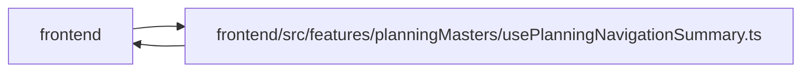

# usePlanningNavigationSummary Module

**Path:** `frontend/src/features/planningMasters/usePlanningNavigationSummary.ts`

## Description

_Auto-generated from `frontend/src/features/planningMasters/usePlanningNavigationSummary.ts`._

## Imports

| Source | Symbols | Type-only | Runtime emission |
|--------|---------|-----------|------------------|
| `../../services/iterationService` | `iterationService` | — | compiler-dependent |
| `../../store/iterationStore` | `useIterationStore` | — | compiler-dependent |
| `../../types/iteration` | `Iteration`, `IterationPlanningReadinessSummary` | Declaration | erased |
| `./planningReturn` | `PLANNING_STEP_IDS` | — | compiler-dependent |
| `@tanstack/react-query` | `useQuery` | — | compiler-dependent |
| `react` | `useMemo` | — | compiler-dependent |

## Module Signals

| Signal | Values |
|--------|--------|
| Exports | `planProgress`, `planningNavigationSummaryKey`, `usePlanningNavigationSummary` |
| Constants | `NO_PROGRESS` |

## Local dependency map

<!-- Auto-generated local dependency summary. Do not edit by hand. -->
This graph shows full source coupling. Type dependencies can be erased; compiler-dependent cycle groups are runtime candidates, not confirmed initialization cycles.

> Module-level dependencies exceed the generated-diagram limits, so the diagram and table below group them by top-level package. Counts report the number of module neighbors in each package.

### Internal neighbors

| Direction | Module |
|---|---|
| Inbound | `frontend` (11) |
| Outbound | `frontend` (4) |

### External packages

| Language | Used packages | Undeclared packages |
|---|---:|---:|
| typescript | 2 | 0 |

> All 15 module neighbor(s) are summarized by package because the module-level view exceeds the 12-node limit.

## Functions

| Function | Signature | Decorators | Description |
|----------|-----------|------------|-------------|
| `planningNavigationSummaryKey` | `(iterationId?: number)` | — | — |
| `planProgress` | `(iteration: Iteration \| null, summary: IterationPlanningReadinessSummary \| undefined)` | — | How far one iteration's plan is, read from its planning readiness response: the server's |
| `usePlanningNavigationSummary` | `()` | — | — |
