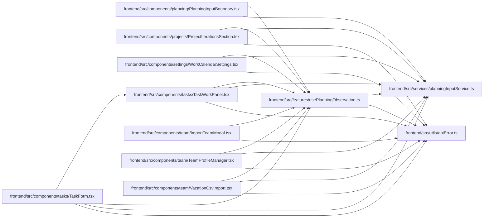

# usePlanningObservation Module

**Path:** `frontend/src/features/usePlanningObservation.ts`

## Description

Editor observations are retained with drafts. Only explicit conflict reapply reads or successful writes advance them; obsolete reads are ignored. The hook separates context loading from user input.

## Imports

| Source | Symbols | Type-only | Runtime emission |
|--------|---------|-----------|------------------|
| `../services/planningInputService` | `ObservedPlanningInput`, `PlanningInputKind`, `MemberPlanningIntent` | Specifier | compiler-dependent |
| `../services/planningInputService` | `planningInputService` | — | compiler-dependent |
| `../utils/apiError` | `getApiErrorStatus` | — | compiler-dependent |
| `react` | `useCallback`, `useEffect`, `useRef`, `useState` | — | compiler-dependent |

## Module Signals

| Signal | Values |
|--------|--------|
| Exports | `usePlanningObservation` |

## Local dependency map

<!-- Auto-generated local dependency summary. Do not edit by hand. -->
This graph shows full source coupling. Type dependencies can be erased; compiler-dependent cycle groups are runtime candidates, not confirmed initialization cycles.

### Internal neighbors

| Direction | Module |
|---|---|
| Inbound | [PlanningInputBoundary](../modules/PlanningInputBoundary.md) |
| Inbound | [ProjectIterationsSection](../modules/ProjectIterationsSection.md) |
| Inbound | [WorkCalendarSettings](../modules/WorkCalendarSettings.md) |
| Inbound | [TaskForm](../modules/TaskForm.md) |
| Inbound | [TaskWorkPanel](../modules/TaskWorkPanel.md) |
| Inbound | [ImportTeamModal](../modules/ImportTeamModal.md) |
| Inbound | [TeamProfileManager](../modules/TeamProfileManager.md) |
| Inbound | [VacationCsvImport](../modules/VacationCsvImport.md) |
| Outbound | [planningInputService](../modules/planningInputService.md) |
| Outbound | [apiError](../modules/apiError.md) |

### External packages

| Language | Used packages | Undeclared packages |
|---|---:|---:|
| typescript | 1 | 0 |

## Functions

| Function | Signature | Decorators | Description |
|----------|-----------|------------|-------------|
| `usePlanningObservation` | `<T>()` | — | — |
