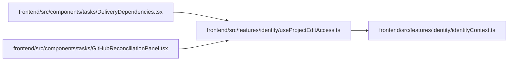

# useProjectEditAccess Module

**Path:** `frontend/src/features/identity/useProjectEditAccess.ts`

## Description

Hook that mirrors the server's edit rule for a project (operator or owner, trusted local mode, or an editor or manager project role; never an observer or an agent) so editing controls are offered only to people the server accepts, and exposes the server feature flags, including the one for retargeting a prerequisite. The server stays the authority.

## Imports

| Source | Symbols | Type-only | Runtime emission |
|--------|---------|-----------|------------------|
| `./identityContext` | `useIdentity` | — | compiler-dependent |

## Module Signals

| Signal | Values |
|--------|--------|
| Exports | `PREREQUISITE_RETARGET_FEATURE`, `useProjectEditAccess` |
| Constants | `PREREQUISITE_RETARGET_FEATURE` |

## Local dependency map

<!-- Auto-generated local dependency summary. Do not edit by hand. -->

### Internal neighbors

| Direction | Module |
|---|---|
| Inbound | [DeliveryDependencies](../modules/DeliveryDependencies.md) |
| Inbound | [GitHubReconciliationPanel](../modules/GitHubReconciliationPanel.md) |
| Outbound | [identityContext](../modules/identityContext.md) |

## Functions

| Function | Signature | Decorators | Description |
|----------|-----------|------------|-------------|
| `useProjectEditAccess` | `(projectId: number \| null \| undefined)` | — | Whether the signed-in person may edit in a project, mirroring the server rule so controls are |
