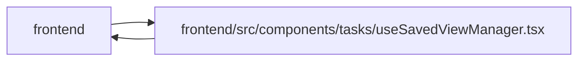

# useSavedViewManager Module

**Path:** `frontend/src/components/tasks/useSavedViewManager.tsx`

## Description

_Auto-generated from `frontend/src/components/tasks/useSavedViewManager.tsx`._

## Imports

| Source | Symbols | Type-only | Runtime emission |
|--------|---------|-----------|------------------|
| `../../i18n/i18n` | `i18n` | — | compiler-dependent |
| `../../services/savedViewService` | `savedViewService` | — | compiler-dependent |
| `../../services/sessionService` | `sessionService` | — | compiler-dependent |
| `../../types/savedView` | `SavedView`, `SavedViewScope` | Declaration | erased |
| `../../utils/apiError` | `getApiErrorMessage` | — | compiler-dependent |
| `../../utils/savedViewState` | `savedViewFilters`, `savedViewModified` | — | compiler-dependent |
| `../common/Button` | `Button` | — | compiler-dependent |
| `../common/ConfirmDialog` | `ConfirmDialog` | — | compiler-dependent |
| `../common/Input` | `Input` | — | compiler-dependent |
| `../common/Modal` | `Modal` | — | compiler-dependent |
| `../common/Select` | `Select` | — | compiler-dependent |
| `../common/Textarea` | `Textarea` | — | compiler-dependent |
| `./TaskFiltersBar` | `TaskFilters` | Declaration | erased |
| `./TaskList` | `SortKey` | Declaration | erased |
| `@tanstack/react-query` | `useMutation`, `useQuery`, `useQueryClient` | — | compiler-dependent |
| `react` | `FormEvent` | Declaration | erased |
| `react` | `useMemo`, `useRef`, `useState` | — | compiler-dependent |

## Module Signals

| Signal | Values |
|--------|--------|
| Exports | `SavedViewManager`, `useSavedViewManager` |
| Constants | `t` |
| Module calls | `t = bind` |

## Local dependency map

<!-- Auto-generated local dependency summary. Do not edit by hand. -->
This graph shows full source coupling. Type dependencies can be erased; compiler-dependent cycle groups are runtime candidates, not confirmed initialization cycles.

> Module-level dependencies exceed the generated-diagram limits, so the diagram and table below group them by top-level package. Counts report the number of module neighbors in each package.

### Internal neighbors

| Direction | Module |
|---|---|
| Inbound | `frontend` (2) |
| Outbound | `frontend` (14) |

### External packages

| Language | Used packages | Undeclared packages |
|---|---:|---:|
| typescript | 2 | 0 |

> All 16 module neighbor(s) are summarized by package because the module-level view exceeds the 12-node limit.

## Classes

| Class | Kind | Line | Bases / Target | Description |
|-------|------|------|----------------|-------------|
| [SavedViewManagerOptions](../entities/SavedViewManagerOptions.md) | Interface | 24 | — | — |
| [EditableScope](../entities/EditableScope.md) | Type alias | 21 | `Exclude<SavedViewScope, 'system'>` | — |
| [FormMode](../entities/FormMode.md) | Type alias | 22 | `'create' \| 'duplicate'` | — |
| [SavedViewManager](../entities/SavedViewManager.md) | Type alias | 333 | `ReturnType<typeof useSavedViewManager>` | — |

## Functions

| Function | Signature | Decorators | Description |
|----------|-----------|------------|-------------|
| `useSavedViewManager` | <pre><code>&#40;&#123;&#10;    filters&#44;&#10;    sortKey&#44;&#10;    systemFilters&#44;&#10;    selectedViewId&#44;&#10;    onSelectedViewIdChange&#44;&#10;    onApplyView&#44;&#10;&#125;&#58; SavedViewManagerOptions&#41;</code></pre> | — | The saved views of the Tasks page and what can be done with the one shown: choose, save as, |
