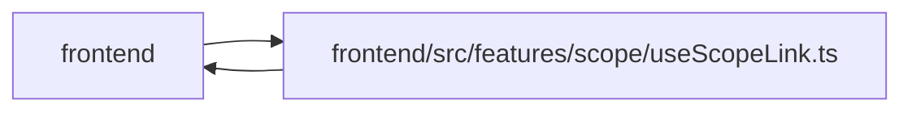

# useScopeLink Module

**Path:** `frontend/src/features/scope/useScopeLink.ts`

## Description

_Auto-generated from `frontend/src/features/scope/useScopeLink.ts`._

## Imports

| Source | Symbols | Type-only | Runtime emission |
|--------|---------|-----------|------------------|
| `../../navigation/scopeParams` | `parseScope` | — | compiler-dependent |
| `./scopeStore` | `RememberedScope` | Specifier | compiler-dependent |
| `./scopeStore` | `useScopeStore` | — | compiler-dependent |
| `./workScope` | `PartialWorkScope` | Specifier | compiler-dependent |
| `./workScope` | `isCompleteScope`, `scopedLink` | — | compiler-dependent |
| `react` | `useCallback`, `useMemo` | — | compiler-dependent |
| `react-router-dom` | `useLocation` | — | compiler-dependent |

## Module Signals

| Signal | Values |
|--------|--------|
| Exports | `ScopeLinkBuilder`, `linkScope`, `scopeLinkNow`, `useLinkScope`, `useScopeLink` |

## Local dependency map

<!-- Auto-generated local dependency summary. Do not edit by hand. -->
This graph shows full source coupling. Type dependencies can be erased; compiler-dependent cycle groups are runtime candidates, not confirmed initialization cycles.

> Module-level dependencies exceed the generated-diagram limits, so the diagram and table below group them by top-level package. Counts report the number of module neighbors in each package.

### Internal neighbors

| Direction | Module |
|---|---|
| Inbound | `frontend` (41) |
| Outbound | `frontend` (3) |

### External packages

| Language | Used packages | Undeclared packages |
|---|---:|---:|
| typescript | 2 | 0 |

> All 44 module neighbor(s) are summarized by package because the module-level view exceeds the 12-node limit.

## Classes

| Class | Kind | Line | Bases / Target | Description |
|-------|------|------|----------------|-------------|
| [ScopeLinkBuilder](../entities/ScopeLinkBuilder.md) | Type alias | 8 | `(to: string, override?: PartialWorkScope) => string` | Builds a link to `to`; values in `override` replace those of the current scope. |

## Functions

| Function | Signature | Decorators | Description |
|----------|-----------|------------|-------------|
| `linkScope` | `(search: string, remembered: RememberedScope) -> PartialWorkScope` | — | The scope a link carries: the URL first, then the remembered scope. |
| `useScopeLink` | `() -> ScopeLinkBuilder` | — | Builds links that carry the current scope to scoped pages. It reads the URL, then the |
| `useLinkScope` | `() -> PartialWorkScope` | — | The scope that links built on this page carry; it can be incomplete before it is known. |
| `scopeLinkNow` | `(to: string) -> string` | — | The same link outside React, for example in an error boundary: the page URL, then the remembered scope. |
