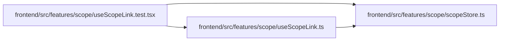

# useScopeLink.test Module

**Path:** `frontend/src/features/scope/useScopeLink.test.tsx`

## Description

_Auto-generated from `frontend/src/features/scope/useScopeLink.test.tsx`._

## Imports

| Source | Symbols | Type-only | Runtime emission |
|--------|---------|-----------|------------------|
| `./scopeStore` | `useScopeStore` | — | compiler-dependent |
| `./useScopeLink` | `scopeLinkNow`, `useScopeLink` | — | compiler-dependent |
| `@testing-library/react` | `renderHook` | — | compiler-dependent |
| `react` | `ReactNode` | Declaration | erased |
| `react-router-dom` | `MemoryRouter` | — | compiler-dependent |
| `vitest` | `beforeEach`, `describe`, `expect`, `it` | — | compiler-dependent |

## Module Signals

| Signal | Values |
|--------|--------|
| Module calls | `describe` |

## Local dependency map

<!-- Auto-generated local dependency summary. Do not edit by hand. -->

### Internal neighbors

| Direction | Module |
|---|---|
| Outbound | [scopeStore](../modules/scopeStore.md) |
| Outbound | [useScopeLink](../modules/useScopeLink.md) |

### External packages

| Language | Used packages | Undeclared packages |
|---|---:|---:|
| typescript | 4 | 0 |
