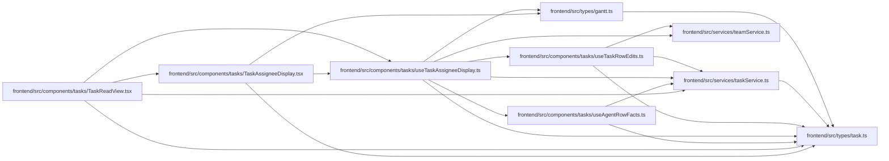

# useTaskAssigneeDisplay Module

**Path:** `frontend/src/components/tasks/useTaskAssigneeDisplay.ts`

## Description

_Auto-generated from `frontend/src/components/tasks/useTaskAssigneeDisplay.ts`._

## Imports

| Source | Symbols | Type-only | Runtime emission |
|--------|---------|-----------|------------------|
| `../../services/taskService` | `taskService` | — | compiler-dependent |
| `../../services/teamService` | `teamService` | — | compiler-dependent |
| `../../types/gantt` | `GanttTask` | Declaration | erased |
| `../../types/task` | `Task` | Declaration | erased |
| `./useAgentRowFacts` | `agentRowValues`, `assigneeKind`, `useAgentRowFacts` | — | compiler-dependent |
| `./useTaskRowEdits` | `assigneeOptionsFrom` | — | compiler-dependent |
| `@tanstack/react-query` | `useQuery` | — | compiler-dependent |

## Module Signals

| Signal | Values |
|--------|--------|
| Exports | `useTaskAssigneeDisplay` |

## Local dependency map

<!-- Auto-generated local dependency summary. Do not edit by hand. -->
This graph shows full source coupling. Type dependencies can be erased; compiler-dependent cycle groups are runtime candidates, not confirmed initialization cycles.

### Internal neighbors

| Direction | Module |
|---|---|
| Inbound | [TaskAssigneeDisplay](../modules/TaskAssigneeDisplay.md) |
| Inbound | [TaskReadView](../modules/TaskReadView.md) |
| Outbound | [useAgentRowFacts](../modules/useAgentRowFacts.md) |
| Outbound | [useTaskRowEdits](../modules/useTaskRowEdits.md) |
| Outbound | [taskService](../modules/taskService.md) |
| Outbound | [teamService](../modules/teamService.md) |
| Outbound | [types_gantt](../modules/types_gantt.md) |
| Outbound | [types_task](../modules/types_task.md) |

### External packages

| Language | Used packages | Undeclared packages |
|---|---:|---:|
| typescript | 1 | 0 |

## Functions

| Function | Signature | Decorators | Description |
|----------|-----------|------------|-------------|
| `useTaskAssigneeDisplay` | `(task: Task \| GanttTask, iterationId: number \| null)` | — | — |
