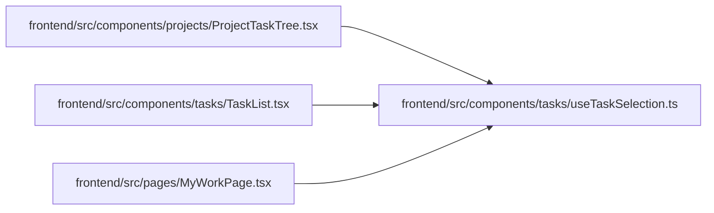

# useTaskSelection Module

**Path:** `frontend/src/components/tasks/useTaskSelection.ts`

## Description

_Auto-generated from `frontend/src/components/tasks/useTaskSelection.ts`._

## Imports

| Source | Symbols | Type-only | Runtime emission |
|--------|---------|-----------|------------------|
| `react` | `useCallback`, `useMemo`, `useRef`, `useState` | — | compiler-dependent |

## Module Signals

| Signal | Values |
|--------|--------|
| Exports | `useTaskSelection` |

## Local dependency map

<!-- Auto-generated local dependency summary. Do not edit by hand. -->

### Internal neighbors

| Direction | Module |
|---|---|
| Inbound | [ProjectTaskTree](../modules/ProjectTaskTree.md) |
| Inbound | [TaskList](../modules/TaskList.md) |
| Inbound | [MyWorkPage](../modules/MyWorkPage.md) |

### External packages

| Language | Used packages | Undeclared packages |
|---|---:|---:|
| typescript | 1 | 0 |

## Classes

| Class | Kind | Line | Bases / Target | Description |
|-------|------|------|----------------|-------------|
| [TaskSelectionOptions](../entities/TaskSelectionOptions.md) | Interface | 3 | — | — |

## Functions

| Function | Signature | Decorators | Description |
|----------|-----------|------------|-------------|
| `useTaskSelection` | `({ selectableIds, order, iterationOf }: TaskSelectionOptions)` | — | Direct row selection: tick any row, shift-click for a range, no mode to enter first. |
