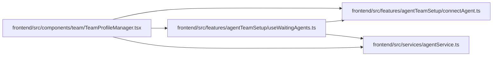

# useWaitingAgents Module

**Path:** `frontend/src/features/agentTeamSetup/useWaitingAgents.ts`

## Description

_Auto-generated from `frontend/src/features/agentTeamSetup/useWaitingAgents.ts`._

## Imports

| Source | Symbols | Type-only | Runtime emission |
|--------|---------|-----------|------------------|
| `../../services/agentService` | `agentService` | — | compiler-dependent |
| `./connectAgent` | `waitingMembers` | — | compiler-dependent |
| `@tanstack/react-query` | `useQuery` | — | compiler-dependent |

## Module Signals

| Signal | Values |
|--------|--------|
| Exports | `useWaitingAgents` |

## Local dependency map

<!-- Auto-generated local dependency summary. Do not edit by hand. -->

### Internal neighbors

| Direction | Module |
|---|---|
| Inbound | [TeamProfileManager](../modules/TeamProfileManager.md) |
| Outbound | [connectAgent](../modules/connectAgent.md) |
| Outbound | [agentService](../modules/agentService.md) |

### External packages

| Language | Used packages | Undeclared packages |
|---|---:|---:|
| typescript | 1 | 0 |

## Functions

| Function | Signature | Decorators | Description |
|----------|-----------|------------|-------------|
| `useWaitingAgents` | `(enabled: boolean)` | — | The team status and topology the Connect steps read, under the same query keys, so a drawer and the |
