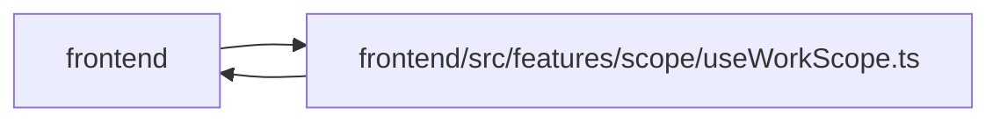

# useWorkScope Module

**Path:** `frontend/src/features/scope/useWorkScope.ts`

## Description

_Auto-generated from `frontend/src/features/scope/useWorkScope.ts`._

## Imports

| Source | Symbols | Type-only | Runtime emission |
|--------|---------|-----------|------------------|
| `../../navigation/scopeParams` | `parseScope` | — | compiler-dependent |
| `../../services/iterationService` | `iterationService` | — | compiler-dependent |
| `./namedIteration` | `forgetCompletedSearchUnless`, `recordCompletedSearch` | — | compiler-dependent |
| `./scopeStore` | `RememberedScope` | Specifier | compiler-dependent |
| `./scopeStore` | `useScopeStore` | — | compiler-dependent |
| `./workScope` | `PartialWorkScope`, `ScopeIterationRecord`, `ScopeIteration`, `ScopeProject`, `WorkScope` | Specifier | compiler-dependent |
| `./workScope` | `defaultIterationForProject`, `hasScopeParams`, `isCompleteScope`, `isScopedPath`, `resolveWorkScope`, `sameScope`, `scopedLink`, `withScopeSearch` | — | compiler-dependent |
| `@tanstack/react-query` | `useQuery` | — | compiler-dependent |
| `react` | `useCallback`, `useLayoutEffect`, `useMemo`, `useRef` | — | compiler-dependent |
| `react-router-dom` | `useLocation`, `useNavigate` | — | compiler-dependent |

## Module Signals

| Signal | Values |
|--------|--------|
| Exports | `WorkScopeCommands`, `WorkScopeValue`, `useSetWorkScope`, `useWorkScope` |

## Local dependency map

<!-- Auto-generated local dependency summary. Do not edit by hand. -->
This graph shows full source coupling. Type dependencies can be erased; compiler-dependent cycle groups are runtime candidates, not confirmed initialization cycles.

> Module-level dependencies exceed the generated-diagram limits, so the diagram and table below group them by top-level package. Counts report the number of module neighbors in each package.

### Internal neighbors

| Direction | Module |
|---|---|
| Inbound | `frontend` (22) |
| Outbound | `frontend` (5) |

### External packages

| Language | Used packages | Undeclared packages |
|---|---:|---:|
| typescript | 3 | 0 |

> All 27 module neighbor(s) are summarized by package because the module-level view exceeds the 12-node limit.

## Classes

| Class | Kind | Line | Bases / Target | Description |
|-------|------|------|----------------|-------------|
| [WorkScopeValue](../entities/WorkScopeValue.md) | Interface | 24 | — | — |
| [WorkScopeCommands](../entities/WorkScopeCommands.md) | Type alias | 43 | `Pick<WorkScopeValue, 'setScope' \| 'setProject' \| 'setIteration'>` | — |

## Functions

| Function | Signature | Decorators | Description |
|----------|-----------|------------|-------------|
| `useSetWorkScope` | `() -> WorkScopeCommands` | — | The commands of useWorkScope for a control inside a page. They follow the same rules: |
| `useWorkScope` | `() -> WorkScopeValue` | — | The current project and iteration. The URL parameters `project` and `iteration` come |
