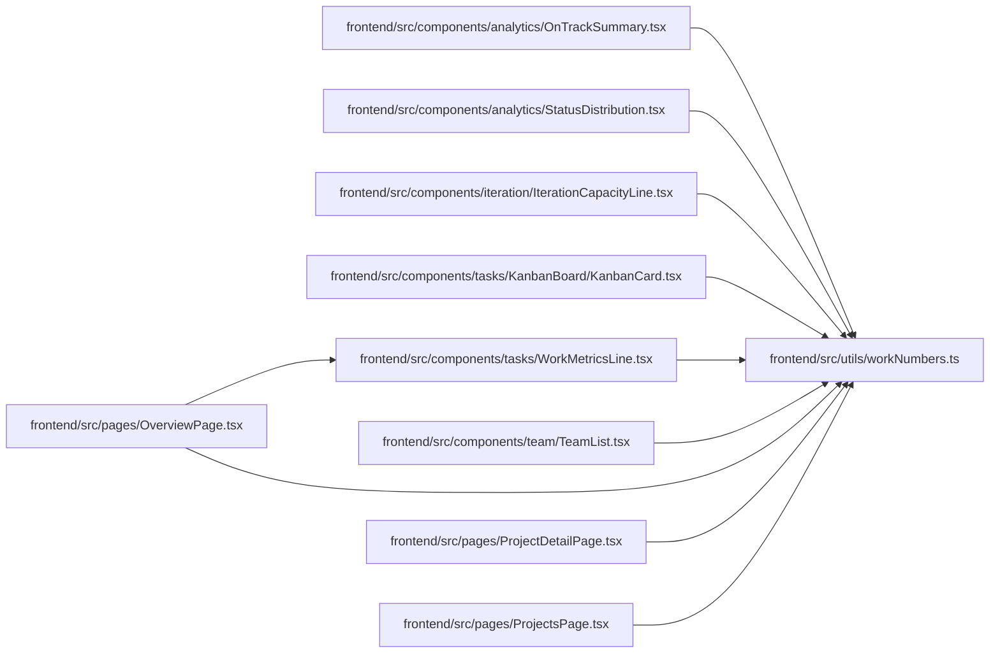

# workNumbers Module

**Path:** `frontend/src/utils/workNumbers.ts`

## Description

/**
 * One way to write work numbers everywhere: counts, decimals, percent and effort
 * in days, in the reader's locale. A missing value returns null so the caller says
 * "unknown" in words instead of showing 0.
 */

## Module Signals

| Signal | Values |
|--------|--------|
| Exports | `formatCount`, `formatDecimal`, `formatEffortDays`, `formatPercent` |

## Local dependency map

<!-- Auto-generated local dependency summary. Do not edit by hand. -->

### Internal neighbors

| Direction | Module |
|---|---|
| Inbound | [OnTrackSummary](../modules/OnTrackSummary.md) |
| Inbound | [StatusDistribution](../modules/StatusDistribution.md) |
| Inbound | [IterationCapacityLine](../modules/IterationCapacityLine.md) |
| Inbound | [KanbanCard](../modules/KanbanCard.md) |
| Inbound | [WorkMetricsLine](../modules/WorkMetricsLine.md) |
| Inbound | [TeamList](../modules/TeamList.md) |
| Inbound | [OverviewPage](../modules/OverviewPage.md) |
| Inbound | [ProjectDetailPage](../modules/ProjectDetailPage.md) |
| Inbound | [ProjectsPage](../modules/ProjectsPage.md) |

## Functions

| Function | Signature | Decorators | Description |
|----------|-----------|------------|-------------|
| `formatCount` | `(value: number \| null \| undefined, locale: string)` | — | — |
| `formatDecimal` | `(value: number \| null \| undefined, locale: string, digits = 1)` | — | — |
| `formatPercent` | `(value: number \| null \| undefined, locale: string)` | — | `value` is 0–100, as the server reports completion. |
| `formatEffortDays` | `(value: number \| null \| undefined, locale: string)` | — | — |
