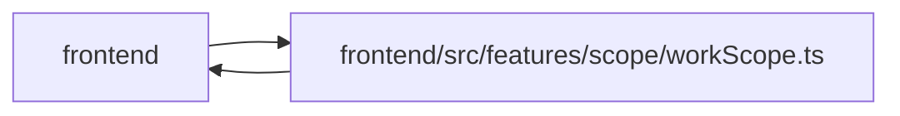

# workScope Module

**Path:** `frontend/src/features/scope/workScope.ts`

## Description

_Auto-generated from `frontend/src/features/scope/workScope.ts`._

## Imports

| Source | Symbols | Type-only | Runtime emission |
|--------|---------|-----------|------------------|
| `../../navigation/destinations` | `DestinationId` | Specifier | compiler-dependent |
| `../../navigation/destinations` | `DESTINATIONS` | — | compiler-dependent |
| `../../navigation/scopeParams` | `formatScope`, `parseScope` | — | compiler-dependent |
| `react-router-dom` | `matchPath` | — | compiler-dependent |

## Module Signals

| Signal | Values |
|--------|--------|
| Exports | `PartialWorkScope`, `SCOPED_DESTINATIONS`, `ScopeIteration`, `ScopeIterationRecord`, `ScopeProject`, `WorkScope`, `defaultIterationForProject`, `hasScopeParams`, `isCompleteScope`, `isScopedPath`, `pickDefaultIteration`, `resolveWorkScope`, `sameScope`, `scopedLink`, `withScopeSearch` |
| Constants | `SCOPED_DESTINATIONS`, `SCOPED_SUBPATHS`, `SCOPED_PATHS` |

## Local dependency map

<!-- Auto-generated local dependency summary. Do not edit by hand. -->
This graph shows full source coupling. Type dependencies can be erased; compiler-dependent cycle groups are runtime candidates, not confirmed initialization cycles.

> Module-level dependencies exceed the generated-diagram limits, so the diagram and table below group them by top-level package. Counts report the number of module neighbors in each package.

### Internal neighbors

| Direction | Module |
|---|---|
| Inbound | `frontend` (16) |
| Outbound | `frontend` (2) |

### External packages

| Language | Used packages | Undeclared packages |
|---|---:|---:|
| typescript | 1 | 0 |

> All 18 module neighbor(s) are summarized by package because the module-level view exceeds the 12-node limit.

## Classes

| Class | Kind | Line | Bases / Target | Description |
|-------|------|------|----------------|-------------|
| [WorkScope](../entities/WorkScope.md) | Interface | 10 | — | — |
| [PartialWorkScope](../entities/PartialWorkScope.md) | Interface | 16 | — | A scope that may be incomplete: read from the URL, remembered, or just chosen. |
| [ScopeIterationRecord](../entities/ScopeIterationRecord.md) | Interface | 21 | — | — |
| [ScopeProject](../entities/ScopeProject.md) | Type alias | 6 | `number \| 'all'` | One project or every project. |
| [ScopeIteration](../entities/ScopeIteration.md) | Type alias | 8 | `number \| 'backlog'` | One iteration, or work that has no iteration. |
| [DatedIteration](../entities/DatedIteration.md) | Type alias | 56 | `{ id: number; start_date: string; end_date: string }` | — |

## Functions

| Function | Signature | Decorators | Description |
|----------|-----------|------------|-------------|
| `isScopedPath` | `(pathname: string) -> boolean` | — | True for the page a scoped destination opens, and for the planning page inside Plan. |
| `sameScope` | `(a: PartialWorkScope \| undefined, b: PartialWorkScope \| undefined) -> boolean` | — | — |
| `isCompleteScope` | `(scope: PartialWorkScope) -> scope is WorkScope` | — | — |
| `pickDefaultIteration` | `<T extends DatedIteration>(iterations: readonly T[], today: string = new Date().toISOString().slice(0, 10)) -> T \| undefined` | — | The one rule every page uses when no valid iteration is selected: the |
| `defaultIterationForProject` | `(iterations: readonly ScopeIterationRecord[], project: ScopeProject, today?: string) -> ScopeIteration` | — | The iteration a project opens on: the one that contains today, else the next one, |
| `resolveWorkScope` | `(primary: PartialWorkScope, fallback: PartialWorkScope, iterations: readonly ScopeIterationRecord[], today?: string) -> WorkScope` | — | Resolves the scope to show. Values in `primary` win over `fallback`; an iteration that |
| `withScopeSearch` | `(search: string, scope: WorkScope) -> string` | — | The search string for a path with the scope written into it; other parameters are kept. |
| `hasScopeParams` | `(search: string) -> boolean` | — | — |
| `scopedLink` | `(to: string, scope: WorkScope \| undefined) -> string` | — | Adds the scope to a link when it opens a scoped page. Other links, and links built |
