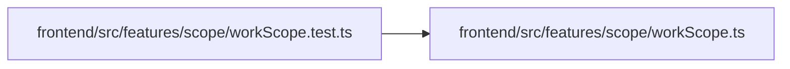

# workScope.test Module

**Path:** `frontend/src/features/scope/workScope.test.ts`

## Description

_Auto-generated from `frontend/src/features/scope/workScope.test.ts`._

## Imports

| Source | Symbols | Type-only | Runtime emission |
|--------|---------|-----------|------------------|
| `./workScope` | `defaultIterationForProject`, `isScopedPath`, `resolveWorkScope`, `scopedLink` | — | compiler-dependent |
| `vitest` | `describe`, `expect`, `it` | — | compiler-dependent |

## Module Signals

| Signal | Values |
|--------|--------|
| Constants | `TODAY`, `ITERATIONS` |
| Module calls | `describe`, `describe`, `describe` |

## Local dependency map

<!-- Auto-generated local dependency summary. Do not edit by hand. -->

### Internal neighbors

| Direction | Module |
|---|---|
| Outbound | [workScope](../modules/workScope.md) |

### External packages

| Language | Used packages | Undeclared packages |
|---|---:|---:|
| typescript | 1 | 0 |
