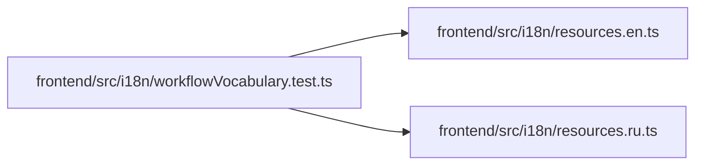

# workflowVocabulary.test Module

**Path:** `frontend/src/i18n/workflowVocabulary.test.ts`

## Description

_Auto-generated from `frontend/src/i18n/workflowVocabulary.test.ts`._

## Imports

| Source | Symbols | Type-only | Runtime emission |
|--------|---------|-----------|------------------|
| `./resources.en` | `englishResources` | — | compiler-dependent |
| `./resources.ru` | `russianResources` | — | compiler-dependent |
| `node:fs` | `readFileSync` | — | compiler-dependent |
| `node:path` | `resolve` | — | compiler-dependent |
| `vitest` | `describe`, `expect`, `it` | — | compiler-dependent |

## Module Signals

| Signal | Values |
|--------|--------|
| Constants | `vocabulary`, `LABEL_KEYS`, `catalogs` |
| Module calls | `describe` |

## Local dependency map

<!-- Auto-generated local dependency summary. Do not edit by hand. -->

### Internal neighbors

| Direction | Module |
|---|---|
| Outbound | [resources.en](../modules/resources.en.md) |
| Outbound | [resources.ru](../modules/resources.ru.md) |

### External packages

| Language | Used packages | Undeclared packages |
|---|---:|---:|
| typescript | 1 | 0 |

## Classes

| Class | Kind | Line | Bases / Target | Description |
|-------|------|------|----------------|-------------|
| [Localized](../entities/Localized.md) | Type alias | 9 | `{ en: string; ru: string }` | — |
| [Entry](../entities/Entry.md) | Type alias | 10 | `{ id: string; name: Localized \| string; group?: Localized }` | — |
| [Vocabulary](../entities/Vocabulary.md) | Type alias | 11 | `Record<'roles' \| 'task_states' \| 'actions' \| 'queues', Entry[]>` | — |
