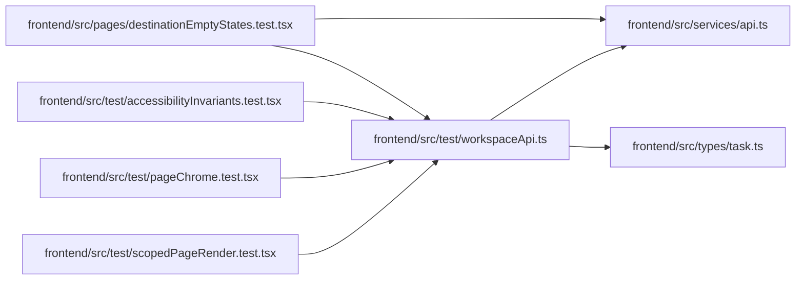

# workspaceApi Module

**Path:** `frontend/src/test/workspaceApi.ts`

## Description

_Auto-generated from `frontend/src/test/workspaceApi.ts`._

## Imports

| Source | Symbols | Type-only | Runtime emission |
|--------|---------|-----------|------------------|
| `../services/api` | `api` | — | compiler-dependent |
| `../types/task` | `Task`, `TaskStatus` | Declaration | erased |
| `vitest` | `vi` | — | compiler-dependent |

## Module Signals

| Signal | Values |
|--------|--------|
| Exports | `WORKSPACE_ITERATIONS`, `WORKSPACE_PROJECTS`, `WORKSPACE_RELEASE`, `WORKSPACE_SHARE`, `WORKSPACE_TASKS`, `installWorkspaceApi` |
| Constants | `WORKSPACE_ITERATIONS`, `WORKSPACE_PROJECTS`, `WORKSPACE_TASKS`, `durations`, `ROUTES`, `WORKSPACE_RELEASE`, `WORKSPACE_SHARE`, `DETAIL_ROUTES` |

## Local dependency map

<!-- Auto-generated local dependency summary. Do not edit by hand. -->
This graph shows full source coupling. Type dependencies can be erased; compiler-dependent cycle groups are runtime candidates, not confirmed initialization cycles.

### Internal neighbors

| Direction | Module |
|---|---|
| Inbound | [destinationEmptyStates.test](../modules/destinationEmptyStates.test.md) |
| Inbound | [accessibilityInvariants.test](../modules/accessibilityInvariants.test.md) |
| Inbound | [pageChrome.test](../modules/pageChrome.test.md) |
| Inbound | [scopedPageRender.test](../modules/scopedPageRender.test.md) |
| Outbound | [api](../modules/api.md) |
| Outbound | [types_task](../modules/types_task.md) |

### External packages

| Language | Used packages | Undeclared packages |
|---|---:|---:|
| typescript | 1 | 0 |

## Functions

| Function | Signature | Decorators | Description |
|----------|-----------|------------|-------------|
| `installWorkspaceApi` | `(extra: Array<[RegExp, (match: RegExpMatchArray) => unknown]> = [])` | — | Answers every GET from the workspace above, with the unplanned ones failing by URL. Restored by `vi.restoreAllMocks`. |
