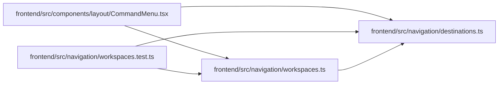

# workspaces Module

**Path:** `frontend/src/navigation/workspaces.ts`

## Description

_Auto-generated from `frontend/src/navigation/workspaces.ts`._

## Imports

| Source | Symbols | Type-only | Runtime emission |
|--------|---------|-----------|------------------|
| `./destinations` | `DestinationId` | Specifier | compiler-dependent |
| `./destinations` | `getDestination`, `getDestinationForPath` | — | compiler-dependent |
| `lucide-react` | `LucideIcon` | Declaration | erased |
| `lucide-react` | `Bot`, `Calendar`, `GanttChartSquare`, `Map`, `Network`, `Repeat`, `Settings`, `Truck` | — | compiler-dependent |

## Module Signals

| Signal | Values |
|--------|--------|
| Exports | `WORKSPACES`, `getWorkspaceForPath` |
| Constants | `VIEW_ITEMS`, `WORKSPACES` |

## Local dependency map

<!-- Auto-generated local dependency summary. Do not edit by hand. -->
This graph shows full source coupling. Type dependencies can be erased; compiler-dependent cycle groups are runtime candidates, not confirmed initialization cycles.

### Internal neighbors

| Direction | Module |
|---|---|
| Inbound | [CommandMenu](../modules/CommandMenu.md) |
| Inbound | [workspaces.test](../modules/workspaces.test.md) |
| Outbound | [destinations](../modules/destinations.md) |

### External packages

| Language | Used packages | Undeclared packages |
|---|---:|---:|
| typescript | 1 | 0 |

## Classes

| Class | Kind | Line | Bases / Target | Description |
|-------|------|------|----------------|-------------|
| [NavItem](../entities/NavItem.md) | Interface | 20 | — | — |
| [WorkspaceMetadata](../entities/WorkspaceMetadata.md) | Interface | 28 | — | — |
| [WorkspaceKey](../entities/WorkspaceKey.md) | Type alias | 18 | `'delivery' \| 'planning' \| 'resource'` | — |

## Functions

| Function | Signature | Decorators | Description |
|----------|-----------|------------|-------------|
| `getWorkspaceForPath` | `(pathname: string) -> WorkspaceMetadata` | — | The old area for a path. An old view page stays in the area that lists it; every other |
